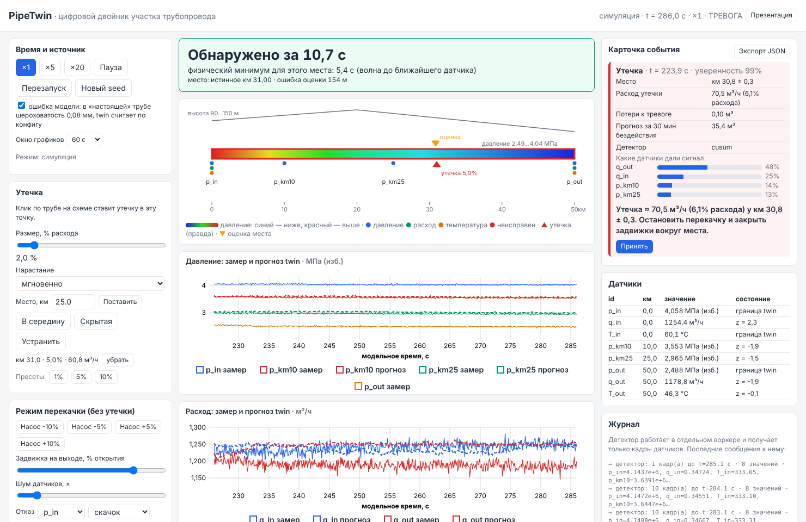
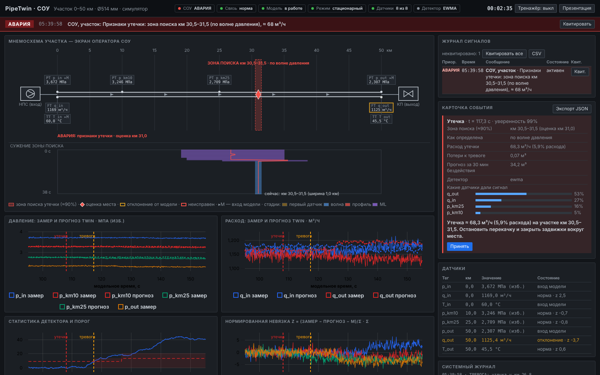
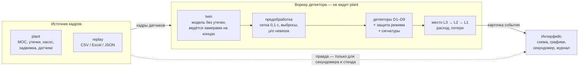

<div align="center">

# PipeTwin

**Цифровой двойник участка трубопровода в браузере и обнаружение утечек в реальном времени**

[](https://github.com/NordManul/Nedra_PipeTwin_team_Innosorogi/actions/workflows/ci.yml)
[](https://github.com/NordManul/Nedra_PipeTwin_team_Innosorogi/actions/workflows/pages.yml)


Кейс **Nedra Digital · PipeTwin** · команда Innosorogi

[Быстрый старт](#быстрый-старт) · [Как это работает](#как-это-работает) · [Результаты](#результаты) · [Адаптация](#адаптация-под-реальные-данные) · [Документы](#документы)



<sub>Сверху — пульт оператора: авария, зона поиска км 30,5–31,5 и как она сужалась (отрезок, ML, затем волна давления), журнал сигналов, карточка с рекомендацией. Ниже, в янтарной рамке, — тренажёр: «реальная» труба с утечкой 5% на км 31, которую оператор не видит. Обнаружено примерно за 10 с при физическом пределе 5,4 с.</sub>

</div>

---

## О проекте

PipeTwin считает физику течения нефти прямо в браузере и сравнивает показания датчиков с прогнозом модели. Если «замер минус модель» устойчиво уходит в сторону, характерную для утечки, система поднимает тревогу, оценивает место, расход утечки и потери и подсказывает, что делать.

Внутри два независимых контура:

| Контур | Что знает | Зачем |
| --- | --- | --- |
| **plant** — «настоящая» труба | Всё: утечки, шум и инерцию датчиков, истинную шероховатость | Источник данных для демо и стенда, «правда» для оценки |
| **twin** — цифровой двойник | Только конфиг трубы (с ошибками параметров) и показания датчиков | Прогноз, от которого считается невязка |

Детектор работает в отдельном воркере и получает только кадры датчиков. Что plant не достижим из кода детекции, проверяет CI (`npm run check:boundaries`).

## Возможности

- **Физика на клиенте.** Дарси–Вейсбах (Коулбрук, Свами–Джейн, Хааланд), теплопотери по Шухову, вязкость от температуры, волны давления по методу характеристик; 1000 узлов — меньше 1 мс на шаг.
- **Детекция.** Девять детекторов (порог, CUSUM, EWMA, баланс массы, волна давления, Калман, их слияние, RLS и PCA без физики), защита от смены режима, сигнатуры событий, монитор отказов датчиков.
- **Зона поиска, а не точка.** Сразу при тревоге — отрезок у датчика, первым увидевшего спад давления; затем зона сужается: ML-оценка в первые секунды, время прихода волны, профиль давлений. Истинное место внутри зоны в ~90% случаев (проверено на стенде). Плюс оценка расхода, потерь и прогноза на 30 минут, карточка события с рекомендацией по правилам из `configs/actions.json`.
- **Несколько утечек и самовосстановление.** Когда место утечки установилось, её вклад учитывается в норме, и система ловит следующую — утечек может быть сколько угодно подряд, у каждой своя авария, зона и карточка. Утечку устранили — система сама видит, что показания вернулись, снимает аварию и гасит красный цвет.
- **ML там, где помогает.** Модель k ближайших соседей обучена на прогонах симулятора и сужает зону в первые 20 секунд тревоги (на 10-й секунде — 7 км вместо 14); дальше физика точнее, и это видно в отчёте по гипотезам.
- **Честный стенд.** Около 1200 сценариев (размер × место × шум × нарастание, смены режима, случайные трубы), калибровка порогов на отдельных seed под 1 ложную тревогу в сутки, выбор стратегии с бутстрэпом.
- **Свои данные.** Импорт CSV, Excel (`.xlsx`) и JSON с автоопределением разделителя, кодировки, формата времени и единиц, маппинг колонок, паспорт трубы текстом, replay записи с наложением искусственной утечки.
- **Пульт оператора и тренажёр.** Мнемосхема в стиле диспетчерских систем (ISA-101): станции, таблички датчиков, зона поиска и её сужение во времени, журнал сигналов с квитированием, строка состояния подсистем. Отдельно — тренажёр с «реальной» трубой: клик ставит утечку, секундомер с физическим минимумом, режимы перекачки, отказы датчиков, слепой режим. Клавиша `T` скрывает тренажёр, `P` — режим презентации.

## Экран оператора



Клавиша `T` убирает тренажёр — остаётся то, что видит диспетчер: мнемосхема участка, зона поиска и её сужение во времени, тренды «замер / прогноз модели», журнал сигналов с квитированием и строка состояния подсистем. Подробно — [apps/web](apps/web/README.md).

## Быстрый старт

Нужны **Node 20+**; для эталона, выбора стратегии и API — **Python 3.11+**.

```bash
npm ci
```

```bash
npm run dev
```

Откроется http://localhost:5173. Нажмите «×20», дождитесь конца прогрева (около минуты модельного времени, в шапке — «Модель: в работе») и кликните по трубе в панели тренажёра — там появится утечка, а на пульте оператора — авария и зона поиска. Трёхминутный сценарий показа — в [docs/demo.md](docs/demo.md).

Статическая сборка (работает без бэкенда и офлайн):

```bash
npm run build
```

## Как это работает



1. **Twin.** Нестационарная модель (метод характеристик) без утечки. Давления на концах участка она берёт из замеров, остальное — прогнозирует. Запаздывание разных датчиков выравнивается, на старте профиль усредняется за 2 с.
2. **Невязки.** Замер минус прогноз по каждому датчику, на сетке 0,1 с, с удалением выбросов. Смещение и шум каждой невязки оцениваются на прогреве и замораживаются при подозрении на утечку. Знаки «как при утечке» берутся из отклика самой модели (`twin.leakResponse`).
3. **Статистика.** Выбранная стендом стратегия — EWMA по согласованному каналу (сумма невязок с весами отклика на утечку); CUSUM — второй, он лучше на малых утечках.
4. **Защита от режима.** Скачок на конце трубы, не похожий на утечку, на полтора пробега волны поднимает порог в 1,5 раза. Сигнатура по порядку первых изменений отличает утечку от насоса, задвижки и отказа датчика.
5. **Зона поиска.** Сразу при тревоге — «ячейка» датчика давления, первым увидевшего спад (волна от утечки раньше всех приходит к ближайшему). Затем зона сужается: ML-оценка по форме отклика (первые ~20 с), время прихода волны к соседним датчикам (если фронт виден), профиль давлений после затухания волн. Каждая стадия откалибрована на стенде под покрытие 90% и берётся в пересечении с первым отрезком. Расход утечки — по дисбалансу и профилю, потери — от момента начала.

## Результаты

Полный прогон стенда: **10 755 прогонов** (1195 сценариев × 9 стратегий), пороги откалиброваны на отдельных seed под 1 ложную тревогу в сутки. Подробности — [results/detection](results/detection/README.md), лидерборд — [results/leaderboard.md](results/leaderboard.md).

| Метрика | EWMA (выбран) | CUSUM (второй) |
| --- | --- | --- |
| Медиана времени обнаружения, утечки от 2% | **11,2 с** | 11,8 с |
| Доля пойманных утечек 1% / 2% / 5% и больше | 72% / 91% / 100% | 83% / 95% / 100% |
| Ложные тревоги без утечки | **0 за 19,3 ч**, 0 на сменах режима, 0 на 250 случайных трубах | так же |
| Утечка 5% сразу после смены режима | поймана всегда, за 4,0 с | за 4,4 с |
| Истинное место внутри зоны поиска | **92%** в момент тревоги, 91% к концу прогона | так же |
| Ошибка точки места, утечки от 5% | 420 м на 50 км | 441 м |
| Тревог раньше физического предела | 0 | 0 |

Зона поиска (отдельный эксперимент, 420 утечек, тестовые seed): медиана ширины 12,8 км в момент тревоги → 9,8 км через 5 с → 7,3 км через 10 с → 1 км, как только виден фронт волны (утечки от 5% — уже к 10-й секунде). Для малых утечек, где волна тонет в шуме, система честно показывает широкую зону, вплоть до всего участка.

Что ещё проверено:

| Вопрос | Ответ |
| --- | --- |
| Сколько датчиков нужно? | 3 → 10 датчиков давления: утечка 5% ловится за 17,8 → 6,0 с, порог уверенного обнаружения падает с 2% до 1% |
| Какая частота опроса? | 1 Гц — 81% пойманных утечек 2–5% за 29 с; 10 Гц — 100% за 14 с; 50 Гц — 100% за 8 с |
| Что если модель трубы неточна? | Шероховатость ±20%, вязкость ±15%, дрейф датчика — 0 ложных тревог, время то же |
| Нужен ли нестационарный twin? | Да: стационарный даёт ложные тревоги на каждой смене режима |
| Скорость интерфейса | JS < 10% кадра, 43 кадра/с в headless Chrome |

Проверено (отклонено или оставлено вариантом):

| Гипотеза | Результат |
| --- | --- |
| Слияние порога и EWMA быстрее лучшего одиночного | Утечки от 2% — 11,4 с, как у EWMA; малых утечек ловит вдвое меньше, чем CUSUM (0,5% — 29% против 60%) |
| Сглаживание граничных давлений twin ускорит детекцию | Шум прогнозов меньше, но остаток становится медленным: порог CUSUM при той же частоте ложных тревог растёт с 57 до 96–226, время для 2% — с 11,9 до 12,7–17,1 с. Фильтр выключен (`twin.inputFilterSec: 0`) |
| Фильтр Калмана на граничных давлениях (без запаздывания на смене режима) ускорит детекцию | На переходах не запаздывает, но медленный шум остаётся: при τ = 1 с время то же (11,9 с), при 2–5 с — 12,9–13,9 с. Фильтр выключен; место к концу прогона чуть точнее (224 м против 273 м) |
| ML уточняет место быстрее физики | Только в первые ~20 с (k ближайших соседей на прогонах симулятора: 7 км вместо 14 на 10-й секунде); дальше волна и профиль точнее, а без волны покрытие ML падает до 80%. ML оставлена стадией первых секунд |
| Несколько детекторов параллельно («ИЛИ»): малую утечку ловит чувствительный, крупную — быстрый | CUSUM ∨ EWMA: скорость EWMA (11,4 с) и почти вся чувствительность CUSUM (1% — 79% против 83%), утечка после смены режима — 2,8 с вместо 4,2; цена — 1 ложная тревога на 250 случайных трубах. Вариант на выбор, по счёту — второй |

Гипотезы по физике — [results/physics](results/physics/README.md), по интерфейсу — [apps/web](apps/web/README.md).

## Адаптация под реальные данные

Всё, что относится к конкретной трубе, — в JSON-конфигах с JSON Schema; в коде физических констант нет. Пошаговая инструкция — [docs/adapting.md](docs/adapting.md).

| Что меняется | Что делать | Код трогать? |
| --- | --- | --- |
| Труба, нефть, датчики | Скопировать `configs/pipeline.default.json`; значения можно писать строками с единицами («530×8 мм», «1,2 МПа») | Нет |
| Формат выгрузки SCADA | `npm run import -- <файл>` — черновик профиля маппинга в `configs/mappings/` | Нет |
| Шум реальных датчиков | `autotune` по записи без утечки; replay с наложением утечки для оценки времени | Нет |
| Требования к ложным тревогам | `configs/selection.json` → `npm run bench` → `npm run select` | Нет |
| Тексты рекомендаций | `configs/actions.json` | Нет |
| Новый детектор | Класс с интерфейсом `Detector` + строка в реестре; стенд и выбор подхватят сам | Один файл |

## Команды

| Команда | Что делает |
| --- | --- |
| `npm run dev` | Интерфейс в режиме разработки |
| `npm run build` | Статическая сборка в `apps/web/dist` |
| `npm test` | Все тесты TypeScript (T-A, T-B, T-C) |
| `npm run typecheck` | Строгая проверка типов всех пакетов |
| `npm run check:boundaries` | Граница честности: детектор не импортирует plant |
| `npm run bench` | Стенд: калибровка порогов и прогоны → `results/runs.csv` (`-- --quick` — за 3 минуты) |
| `npm run select` | Выбор стратегии → `configs/strategy.selected.json`, лидерборд, отчёт |
| `npm run import -- <файл>` | Чужой файл → кадры в СИ и черновик маппинга |
| `npm run perf` | Время шага модели |
| `python3 -m pytest -q` | Тесты Python (эталон SciPy, выбор стратегии, API) |
| `python3 python/reference/compare_ts_py.py` | Сверка TypeScript-модели с SciPy (расхождение < 0,1%) |

Опции стенда: `--suite e3,e4,e5,e6,e7,noleak,random,files`, `--config <pipeline.json>`, `--strategies <файл>`, `--reuse-tuned`, `--workers N`, `--no-cache`, `--out <runs.csv>`.

## Структура репозитория

```
apps/web          интерфейс: схема, графики, карточка; воркеры симуляции, детектора и импорта
packages/core     контракты, единицы, конфиг, физика, twin; plant — packages/core/src/plant
packages/detect   предобработка, детекторы D1–D9, сигнатуры, локализация, объяснение, autotune
packages/io       импорт CSV / Excel / JSON, время, маппинг, паспорт, replay
packages/bench    сценарии, прогоны, калибровка порогов, метрики
python/           эталон SciPy, выбор стратегии, гипотезы, FastAPI
configs/          труба, сценарии, маппинги, правила рекомендаций, веса выбора, выбранная стратегия
schemas/          JSON Schema для всех файлов configs/ — общие для TypeScript и Python
fixtures/         образцы «неудобных» форматов для тестов импорта
results/          лидерборд, отчёт, гипотезы по физике и детекции
scripts/          проверка границ, замер скорости, измерения для гипотез
docs/             ТЗ, контракты, адаптация, сценарий демо
```

## Тестирование

- **TypeScript** — 81 тест (vitest): физика сверяется с аналитикой и эталоном, детекция — на синтетике с известной правдой, импорт — на образцах из `fixtures/import`.
- **Python** — эталонная модель SciPy, выбор стратегии, API.
- **CI** на каждый коммит: типы, граница честности, тесты TS и Python, быстрый стенд с выбором стратегии, сборка. Демо публикуется на GitHub Pages из `main`.

## Принципы

- Внутри всё в СИ: Па (абсолютное давление), К, м, м³/с, с. Перевод единиц — только на границе.
- Время — секунды от начала потока; датчики — по строковому `id`.
- Пороги — в единицах σ невязки и калибруются стендом, а не подбираются руками.
- Тревога раньше физического предела (волна ещё не дошла до датчика) считается ошибкой стенда.
- Изменение контракта — отдельный коммит с префиксом `contracts:` ([docs/contracts.md](docs/contracts.md#36-как-менять-контракт)).

## Документы

| Документ | О чём |
| --- | --- |
| [docs/PipeTwin_TZ.md](docs/PipeTwin_TZ.md) | Техническое задание команды |
| [docs/contracts.md](docs/contracts.md) | Контракты между модулями: типы, файлы, единицы, правила изменения |
| [docs/adapting.md](docs/adapting.md) | Как адаптировать под новые данные и новое ТЗ — по шагам |
| [docs/demo.md](docs/demo.md) | Трёхминутный сценарий защиты и пресеты |
| [results/](results) | Лидерборд, отчёт, гипотезы |

## Команда

Innosorogi. Роли по ТЗ: **A** — физика и цифровой двойник, **B** — детекция, стенд и выбор стратегии, **C** — данные, интерфейс и интеграция.
