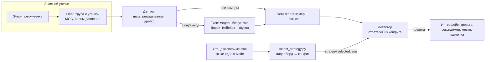
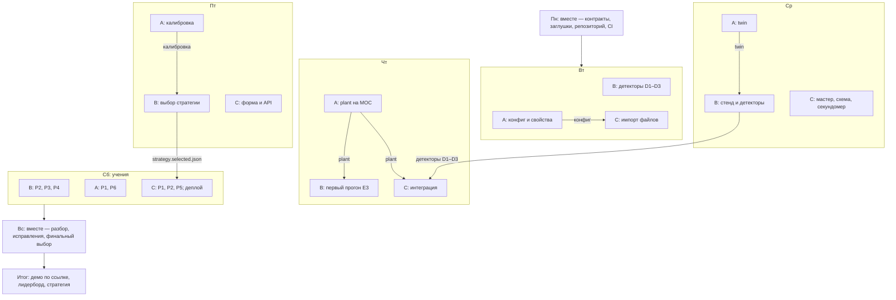

# PipeTwin — техническое задание команды на подготовку к хакатону

> Кейс: **Nedra Digital: PipeTwin** (для студентов 1–2 курсов, программы ТОП ИТ, ТОП ДС, ТОП ИТ ПРО, ДС).
> Статус: подготовка до выдачи задания. Дата: 2 ноября 2026. Команда: 3 человека (A, B, C).
> Живая версия документа: https://claude.ai/artifact/DZD2aW5VJz8dHsrETEyTY1

## Содержание

1. [Коротко](#1-коротко)
2. [Что известно о задаче](#2-что-известно-о-задаче)
3. [Как это работает без данных: тестирование, обучение, честность](#3-как-это-работает-без-данных)
4. [Ориентир на цели Nedra Digital](#4-ориентир-на-цели-nedra-digital)
5. [Архитектура](#5-архитектура)
6. [Датчики](#6-датчики)
7. [Контракты между модулями](#7-контракты-между-модулями)
8. [Адаптация к данным, которых ещё нет](#8-адаптация-к-данным-которых-ещё-нет)
9. [Кто за что отвечает](#9-кто-за-что-отвечает)
10. [Участник A — физика и цифровой двойник](#10-участник-a--физика-и-цифровой-двойник)
11. [Участник B — детекция, стенд, выбор стратегии](#11-участник-b--детекция-стенд-выбор-стратегии)
12. [Участник C — данные, интерфейс, интеграция](#12-участник-c--данные-интерфейс-интеграция)
13. [План экспериментов](#13-план-экспериментов)
14. [Автоматический выбор стратегии](#14-автоматический-выбор-стратегии)
15. [Учения с данными-загадками](#15-учения-с-данными-загадками)
16. [План недели и граф работы](#16-план-недели-и-граф-работы)
17. [После выдачи задания, риски, открытые вопросы](#17-после-выдачи-задания-риски-открытые-вопросы)
18. [Источники](#18-источники)

---

## 1. Коротко

- **Что строим.** Цифровой двойник участка трубопровода в браузере: физическая модель течения (Дарси–Вейсбах + теплопотери) считается на клиенте, система в реальном времени ловит утечку по расхождению «замер минус модель». Жюри ставит утечку мышкой и смотрит, за сколько секунд её поймают.
- **Главная идея архитектуры.** Два независимых контура: **plant** — «настоящая» труба с утечкой, шумом и инерцией датчиков (знает правду); **twin** — модель без утечки, видит только показания датчиков. Детектор работает только с невязкой и никогда не видит факт утечки.
- **Как готовимся без задания.** Данные генерирует наш же симулятор с известным ответом, поэтому тестировать можно тысячи сценариев. Всё, что «учится» (шум, пороги, неизвестные параметры трубы), учится на данных *без утечки* — их можно получить из первой минуты любого потока, нашего или чужого.
- **Как выбираем решение.** Девять детекторов соревнуются на стенде на сотнях случайных труб при одинаковом уровне ложных тревог; скрипт сам выбирает победителя и пишет его в конфиг приложения.
- **Как готовимся к неизвестным материалам.** Всё через конфиг, параметры со статусами `given / default / calibrated`, импорт любых файлов через мастер маппинга, учения с «чужими» пакетами данных.
- **Роли.** A — физика; B — детекция и эксперименты; C — данные, интерфейс, интеграция. Работа параллельная, синхронизация через контракты и семь точек передачи.

## 2. Что известно о задаче

**Из анонса**

- Цифровой двойник участка трубопровода в браузере.
- Физика: уравнение Дарси–Вейсбаха и тепловые потери, считается на клиенте.
- Утечка детектируется по расхождению смоделированного и «замеренного» давления, в реальном времени.
- Данные генерирует сам симулятор; жюри ставит утечку мышкой и смотрит, за сколько секунд система её поймает.
- Стек: Python/FastAPI или чистый TypeScript, SciPy, WebGL по желанию.

**Допущения (проверить после выдачи задания)**

| Параметр | Берём по умолчанию | Почему |
| --- | --- | --- |
| Среда | Несжимаемая жидкость (нефть) | Дарси–Вейсбах + теплопотери = типичная горячая перекачка нефти |
| Длина участка | 10–100 км | Типовой магистральный участок |
| Режим | Нестационарный в plant, квазистационарный в twin | Утечка в реальности даёт волну давления ~1000 м/с, это делает время детекции честным |
| Датчики | Давление и температура в 3–10 точках, расход на входе и выходе | Минимум для балансового метода и локализации |
| Частота опроса | 10 Гц, шум 0,1–0,5% шкалы | Реалистично для SCADA |

## 3. Как это работает без данных

### 3.1. На чём тестировать

Симулятор — генератор данных с заранее известным ответом. Сценарий — файл с событиями во времени:

```json
{
  "pipeline": "configs/pipeline.default.json",
  "duration_s": 120, "seed": 7, "noise_pct": 0.3,
  "events": [
    { "t": 30, "type": "pump", "change_pct": 10 },
    { "t": 60, "type": "leak", "x_m": 23000, "size_pct": 2, "ramp_s": 5 }
  ]
}
```

Стенд проигрывает его так же, как если бы жюри кликнуло в 60-ю секунду. Мы знаем время и место утечки, поэтому считаем время детекции, ошибку места, ложные тревоги (например, на смене режима насоса в 30-ю секунду). Тысячи сценариев — за минуты.

### 3.2. Как не обмануть самих себя

Если детектор и симулятор — одна модель, детекция будет идеальной и бессмысленной. Поэтому:

- **Plant и twin — разные модели.** Plant нестационарный (волны давления, шум, дрейф, пропуски); twin — упрощённый стационарный, как модель у диспетчера.
- **Twin не знает истинных параметров.** В plant шероховатость 0,08 мм, twin считает 0,05 мм — ошибка модели, как в жизни.
- **Детектор не видит plant**, только датчики. Проверяется линтером в CI.
- **Plant специально хуже реальности:** больше шума, выбросы, отказы датчиков, переключения режимов.

### 3.3. На чём обучать

Нейросети с датасетом утечек нет. Настраиваются четыре вещи:

- уровень шума каждого датчика;
- неизвестные параметры трубы (шероховатость, теплопередача, смещения датчиков) — калибровка;
- пороги детекторов;
- регрессия в детекторах без физики (D8, D9).

Всё это настраивается на данных **без утечки** — первые 60 секунд любого потока. Поэтому система сама подстраивается под любые данные: нашу симуляцию, чужую трубу, реальную запись. Заранее на стенде «обучается» только выбор стратегии и настройки по умолчанию — на сотнях случайных труб.

### 3.4. Как понять, что система работает

1. **Физика — против известных ответов:** гидроудар Жуковского, диаграмма Муди, формула Шухова (тесты T-A).
2. **Детекция — по цифрам стенда:** время детекции, доля пойманных, ложные тревоги в час. Пороги подбираются на одних seed, проверяются на других.
3. **Адаптивность — учения:** пакеты данных в «чужом» формате, засекаем минуты до работающего демо.

Порядок работы: за 1–2 дня собрать сквозной минимальный вариант (простейший plant + twin + порог + кнопка утечки + секундомер), получить первые цифры стенда и дальше улучшать то, что сильнее всего тянет метрику вниз. «Работает» = есть число, и оно улучшается.

### 3.5. Честность и как побеждать

«Поймать» утечку за 0 с можно одной строкой — симулятор знает клик. Поэтому вероятнее оценивают, перенесётся ли подход на настоящую трубу. Как жюри может проверить (точно не знаем, наиболее вероятно):

- код и архитектура: получает ли детектор что-то кроме датчиков;
- **физический предел:** утечка видна, только когда волна дойдёт до ближайшего датчика (10 км при ~1000 м/с ≈ 10 с). Детекция быстрее предела — признак обмана;
- смена режима насоса или задвижки без утечки — честная система не должна дать ложную тревогу;
- свои данные с утечкой, известной только жюри;
- вопросы: почему именно 2,4 с, что при большем шуме, как выбран порог.

Что делаем, чтобы доказать честность сами:

- детектор в отдельном воркере, получает только кадры датчиков, журнал сообщений виден на экране;
- рядом с секундомером — «физический минимум для этого места: 1,9 с, поймали за 2,4 с»;
- слепой режим: запись жюри или утечка со скрытой задержкой;
- жюри само крутит насос, задвижку, шум — ложных тревог нет;
- кроме факта утечки — место (ошибка в метрах) и объём;
- цифры стенда на слайде как доказательство, что выбор сделан по данным.

## 4. Ориентир на цели Nedra Digital

PipeTwin строим как естественное продолжение их продукта Nedra.DIGITAL TWIN: та же логика «двойник знает норму и сигналит об отклонении», но в нише, которую они публично не закрывают, — обнаружение утечки за секунды на физической модели.

**Что у них есть (по описаниям на сайте)**

- **Nedra.DIGITAL TWIN** — цифровой двойник обустройства месторождения с управлением в реальном времени; модули Well, Gas, Pipe.
- **Gas** — ранние аномалии и прогноз отказов газоперекачивающих агрегатов, турбодетандеров, турбин; рекомендации из базы дефектов; минимум ложных срабатываний; анализ при смене режима.
- **Pipe** — ML-прогноз дефектов и остаточного ресурса трубопроводов по истории ремонтов, ранжирование участков по риску. Горизонт — месяцы и годы.

| | Их Gas | Их Pipe | Наш PipeTwin |
| --- | --- | --- | --- |
| Объект | Компрессоры, турбины | Трубопроводы | Участок трубопровода |
| Что ищем | Развивающийся отказ оборудования | Износ, коррозия, остаточный ресурс | Утечку |
| Масштаб времени | Дни, недели | Месяцы, годы | Секунды |
| Основа | ML на истории работы | ML на истории ремонтов | Физика течения + статистика |

**Позиционирование на защите:** «Pipe говорит, какой участок может отказать в следующем году. PipeTwin ловит утечку в момент, когда она случилась, и говорит где и сколько».

| Что ценит Nedra | Что делаем | Кто |
| --- | --- | --- |
| Ранний сигнал при минимуме ложных срабатываний | Ложные тревоги — жёсткий фильтр выбора стратегии; на слайде кривая «время детекции против ложных тревог» | B |
| Анализ при смене режима | Эксперимент E5 и сигнатурный фильтр обязательны; на демо жюри само меняет режим | B |
| Карточки аномалий, рекомендации, объяснение сигнала | Карточка события: тип, место ± ошибка, расход утечки, уверенность, какие датчики дали сигнал, действие | B + C |
| Данные с АСУТП в реальном времени | Импорт тэгов SCADA, потоковый источник, учебный пакет P2 | C |
| Адаптация под специфику любой компании | Всё через конфиг, неизвестные параметры калибруются по данным | A |
| Экономический эффект | Метрика «объём потерь до обнаружения» и сравнение с простым порогом | B |

Связь кейса с этими модулями — наша гипотеза; уточнить у организаторов.

## 5. Архитектура

Физика и детекторы пишутся один раз на TypeScript и работают и в браузере, и в Node-стенде экспериментов — тестируем ровно тот код, который увидит жюри. Python со SciPy — эталон для проверки физики, калибровка и анализ результатов.

### 5.1. Поток данных



Всё, что знает об утечке, — в зоне «Знает об утечке». Детектор получает только невязку между замерами и прогнозом twin, а стратегию берёт из файла, который пишет стенд.

### 5.2. Стек

| Слой | Технология | Зачем |
| --- | --- | --- |
| Ядро физики и детекторы | TypeScript, без зависимостей от DOM | Один код для браузера и стенда |
| Валидация конфигов | zod (TS), pydantic (Python), общая JSON Schema | Ошибка в чужих данных видна сразу, с понятным текстом |
| Расчёт в браузере | Web Worker | UI не тормозит, тик модели не зависит от отрисовки |
| Фронтенд | Vite + TypeScript, Canvas 2D или SVG, графики uPlot | Быстрые графики на 10 Гц; WebGL — только если останется время |
| Стенд экспериментов | Node (tsx), запуск ядра без браузера | Тысячи прогонов Монте-Карло за минуты |
| Эталон и анализ | Python 3.11, numpy, scipy, pandas, matplotlib | Сверка физики, калибровка, отчёт и выбор стратегии |
| Бэкенд (опционально) | FastAPI | Пресеты, приём логов, разбор тяжёлых форматов; приложение работает и без него |

### 5.3. Структура репозитория

```
pipetwin/
  configs/
    pipeline.default.json      # геометрия, жидкость, датчики, среда
    scenarios/*.json           # сценарии экспериментов
    mappings/*.json            # профили маппинга колонок чужих файлов
    actions.json               # таблица правил рекомендаций
    selection.json             # веса выбора стратегии
    strategy.selected.json     # победившая стратегия, пишет select_strategy.py
  data/                        # сюда кладём ресурсы организаторов
  fixtures/import/             # файлы-образцы для тестов импорта
  packages/core/               # A: единицы, конфиг, жидкость, трение, twin, plant, датчики, калибровка
  packages/detect/             # B: предобработка, детекторы, сигнатуры, локализация, объяснение
  packages/bench/              # B: генератор сценариев, раннер, метрики
  packages/io/                 # C: импорт CSV/Excel/JSON, маппинг колонок
  apps/web/                    # C: интерфейс, воркер, визуализация
  python/
    reference/                 # A: эталонная модель на SciPy
    analysis/                  # B: ноутбуки, select_strategy.py
    api/                       # C: FastAPI (опционально)
  results/                     # CSV прогонов, лидерборд, отчёты
```

### 5.4. Как обеспечить лёгкую замену ресурсов

- Все параметры — только в `configs/*.json`. В коде нет ни одной физической константы трубы.
- Внутри всё в СИ. Перевод единиц (бар, °C, м³/ч, мм) — только на границе, в загрузчике.
- Данные идут через интерфейс `DataSource`: `SimulatedSource` (наш plant), `ReplaySource` (CSV с замерами), при необходимости `StreamSource` (API организаторов).
- Модели свойств подключаемые: вязкость от температуры, плотность от температуры, коэффициент трения — выбираются строкой в конфиге.
- Детекторы регистрируются в реестре по имени. Стратегия = JSON с именем детектора и параметрами.
- Цель: «чужой» конфиг (другая длина, диаметр, жидкость, число датчиков) до работающего демо — не больше 10 минут.

## 6. Датчики

Датчики задаём сами. В симуляторе датчик — не устройство, а точка модели, в которой мы разрешаем «подсмотреть» значение. Модель A считает давление, расход и температуру во всех узлах сетки (например, каждые 100 м) — это «истина», которую в реальности целиком никто не видит. Датчик берёт значение в одной точке и портит его так, как портит настоящий прибор: шум, запаздывание, медленный дрейф, округление до разрешения прибора, пропуски и выбросы. Детектор видит только то, что прошло через датчики.

```json
"sensors": [
  { "id": "p_in",   "kind": "p", "x": 0,     "noisePct": 0.2, "lagSec": 0.5 },
  { "id": "q_in",   "kind": "q", "x": 0,     "noisePct": 0.5 },
  { "id": "T_in",   "kind": "T", "x": 0,     "noiseK": 0.1 },
  { "id": "p_km10", "kind": "p", "x": 10000, "noisePct": 0.2 },
  { "id": "p_km25", "kind": "p", "x": 25000, "noisePct": 0.2 },
  { "id": "p_out",  "kind": "p", "x": 50000, "noisePct": 0.2 },
  { "id": "q_out",  "kind": "q", "x": 50000, "noisePct": 0.5 },
  { "id": "T_out",  "kind": "T", "x": 50000, "noiseK": 0.1 }
]
```

- **Почему не везде.** Датчик в каждом узле без шума даёт мгновенную точную детекцию, но так на реальной трубе не бывает, и жюри это поймёт.
- **Расстановка по умолчанию** (наше допущение, не норматив): давление на входе, выходе и через 10–20 км по трассе; расход только на входе и выходе (расходомеры дорогие); температура на входе и выходе; опрос ~10 Гц, шум давления — десятые доли процента шкалы.
- **Если дадут свою расстановку** — берём её: это только конфиг. Каждый детектор объявляет нужные датчики (`requires`); нет расходомеров — балансовые детекторы выбывают, остальные работают. Если дадут записи — шум, запаздывание и дрейф оцениваем по ним.
- **Эксперимент E4** отвечает, сколько датчиков нужно и где («при 3 датчиках ловим от 2% расхода, при 10 — от 0,5%»). Отдельно проверяем худшее место — посередине между датчиками.

## 7. Контракты между модулями

### 7.1. Что это и зачем

Контракт — договорённость, в каком виде одна часть системы передаёт данные другой: поля, единицы, функции и что они возвращают. Как стандарт розетки: производители чайника и розетки не встречались, но вилка подходит.

- **Параллельная работа.** C не ждёт модель A: пишет интерфейс под контракт с заглушкой, потом подменяет её одной строкой.
- **Замена ресурсов.** Для данных организаторов пишется только адаптер в формат контракта.
- **Честность.** Детектору по контракту передаются только показания датчиков.
- **Меньше споров при сборке:** без контракта в четверг выяснится, что A отдаёт бары, B ждёт паскали, а C рисует по номерам датчиков.

| Контракт | Что описывает | Кто создаёт | Кто использует |
| --- | --- | --- | --- |
| `PipelineConfig` | Труба, жидкость, датчики, граничные условия | C (импорт), A (схема) | A, B, C |
| `SensorFrame` | Показания всех датчиков в момент t | A (plant) или C (запись) | B, C |
| `TwinPrediction` | Что модель ожидает на датчиках | A (twin) | B, C |
| `Detector` | Кадр + прогноз → тревога, место, объём | B | C, стенд |
| `DataSource` | Откуда идут кадры: симулятор, запись, API | A, C | C, стенд |
| `scenario.json`, `runs.csv` | Сценарий эксперимента и его результат | B | A, B, C |

### 7.2. Правила

- Внутри системы всё в СИ: Па, К, м, м³/с, с.
- Время — секунды от начала (float), не номер отсчёта.
- Датчики адресуются строковым `id` (`"p_km12"`), не индексом массива.
- Детектор никогда не импортирует ничего из plant (`eslint-plugin-boundaries` или `dependency-cruiser` в CI).
- Добавить необязательное поле — можно, предупредив остальных. Переименовать или удалить — только с согласия всех троих. Каждое изменение — отдельный коммит с пометкой `contracts:`.

### 7.3. Типы (`packages/core/src/contracts.ts`)

```typescript
export interface SensorSpec {
  id: string;                    // "p_km12"
  kind: 'p' | 'T' | 'q';         // давление, температура, расход
  x: number;                     // положение от входа, м
  noiseStd: number; lagSec: number; drift?: number;
}

export interface PipelineConfig {
  geometry: { length: number; diameter: number; wallThickness: number;
              roughness: number; elevation: [x: number, z: number][] };
  fluid: { name: string; density: PropertyModel; viscosity: PropertyModel;
           heatCapacity: number; bulkModulus: number };
  thermal: { ambientTemp: number; heatTransferCoef: number };
  boundary: { inletPressure: Schedule; outletPressure: Schedule; inletTemp: number };
  sensors: SensorSpec[];
  numerics: { dx: number; frictionModel: 'colebrook' | 'swamee-jain' | 'haaland' };
}

export interface SensorFrame {
  t: number;                           // с
  values: Record<string, number>;      // id датчика → значение в СИ
  valid?: Record<string, boolean>;     // false = пропуск или сбой
}

export interface TwinPrediction { t: number; values: Record<string, number> }

// Знает только plant
export interface LeakEvent { x: number; area: number; cd: number; tStart: number; rampSec: number }

export interface DetectorOutput {
  alarm: boolean;
  score: number;        // уверенность, для порогов и графиков
  location?: number;    // м от входа
  leakRate?: number;    // м³/с
}

export interface Detector {
  name: string;
  requires: Array<'p' | 'T' | 'q'>;
  reset(cfg: PipelineConfig, params: Record<string, number>): void;
  update(frame: SensorFrame, pred: TwinPrediction): DetectorOutput;
}

export interface DataSource {
  sensors: SensorSpec[];
  step(dt: number): SensorFrame | null;          // null = данные кончились
  injectLeak?(e: LeakEvent): void;               // только у симулятора
}
```

### 7.4. Форматы файлов

- **Сценарий** (`configs/scenarios/*.json`): ссылка на конфиг трубы, утечки с временем, режимные события (смена давления насоса, прикрытие задвижки), уровень шума, seed, длительность.
- **Результат прогона** (`results/runs.csv`), строка на пару «сценарий × стратегия»: `scenario_id, strategy_id, seed, leak_present, leak_x, leak_frac, t_leak, t_alarm, ttd, false_alarms, loc_est, loc_err, rate_est, rate_err, v_loss, cpu_ms_per_tick`.
- **Лог тиков** (`results/ticks/*.parquet`, опционально): невязки и score по времени для разбора отдельных прогонов.

### 7.5. Как сделать в понедельник (~4 часа вместе)

1. Договориться о правилах из 7.2 (15 мин).
2. Написать типы в `contracts.ts` — только описания, без логики (1 ч).
3. Файлы-примеры: `configs/pipeline.example.json` и `fixtures/frames.example.csv` на 100 строк (30 мин).
4. Заглушки (1 ч): `FakeSource` — давления с шумом, по `injectLeak` все давления плавно падают на 1%; `FakeTwin` — средние значения из конфига; `ThresholdDetector` — тревога при отклонении > 3σ.
5. Сквозной тест (30 мин): `FakeSource → FakeTwin → ThresholdDetector`, утечка в 60-ю секунду, печать времени тревоги. Живёт в CI всю неделю.

**Типичные ошибки:** не договорились о единицах; датчики по индексу (добавили датчик — графики съехали); время в отсчётах (сменили частоту — пороги сломались); контракт есть, а сквозного теста нет.

## 8. Адаптация к данным, которых ещё нет

Мы не угадываем формат материалов, а делаем так, чтобы любой из них проходил через три слоя: **импорт → нормализованный конфиг и поток кадров → калибровка модели и автонастройка порогов**. Всё, что ниже (физика, детекторы, интерфейс), при смене данных не правится.

**Семь правил, обязательных для всех**

1. Каждый параметр имеет статус: `given` (дали организаторы), `default` (из библиотеки), `calibrated` (подобрали по данным). Статус виден в интерфейсе и логах.
2. Модель подстраивается под данные: шероховатость, теплопередача и смещения датчиков подбираются по участку без утечки.
3. Детекторы работают в долях шума (σ) и секундах, а не в паскалях и отсчётах — пороги переносятся между трубами и частотами.
4. Каждый детектор объявляет `requires`. Нет нужных датчиков — выбывает из турнира, а не падает.
5. Есть запасной путь без физики: детектор на взаимном предсказании датчиков (D8, D9).
6. Стратегия выбирается на сотнях случайных труб, а не на одной нашей.
7. Полученные записи сразу становятся сценариями стенда (replay), выбор стратегии перезапускается на них.

**Что можем получить и что срабатывает**

| Что можем получить | Что срабатывает | Кто | Цель по времени |
| --- | --- | --- | --- |
| Только текст задания, как сейчас | Всё как есть: наш plant генерирует данные | — | 0 |
| Параметры трубы таблицей, PDF или текстом | Импорт «ключ — значение» или форма; недостающее — default + калибровка | C, A | 15 мин |
| Записи датчиков без утечек | Replay, оценка шума, калибровка twin, автонастройка порогов | C, A, B | 30 мин |
| Записи с размеченными утечками | В тестовый набор стенда, повторный выбор стратегии | B | 30 мин |
| Только давления, без расходомеров | Детекторы с `requires: q` выбывают; twin по двум давлениям | A, B | 10 мин |
| Газ вместо жидкости | Модель среды «газ», изотермическая стационарная формула | A | 2–3 ч |
| Несколько участков, насосные станции | Граф участков, граничное условие «насос» | A | 3–4 ч |
| Свой симулятор или API организаторов | Адаптер `DataSource`; наш plant остаётся для стенда | C | 1 ч |
| Жёстко заданный стек, например только Python | TS-ядро в браузере сохраняем; если TS запрещён — порт по эталону `python/reference` | все | 4–6 ч |
| Своя метрика оценки | Веса в `selection.json`, при необходимости новая метрика | B | 15 мин |

## 9. Кто за что отвечает

- **A — физика.** Модель трубы: «настоящая» труба с утечкой и двойник без утечки; подстройка модели под любую трубу.
- **B — детекция.** Алгоритмы поиска утечки, стенд экспериментов, автоматический выбор лучшей стратегии, объяснение сигнала.
- **C — данные и интерфейс.** Загрузка любых файлов, демо в браузере для жюри, сборка всех частей и выкладка.

| Участник | Зона | Главный вопрос к 8 ноября |
| --- | --- | --- |
| A | Свойства среды, трение, twin, plant на MOC, калибровка | Точна ли модель и подстраивается ли под любую трубу по данным? |
| B | Предобработка, детекторы, стенд, выбор стратегии | Какая стратегия ловит утечку быстрее всех при допустимых ложных тревогах, на любой трубе? |
| C | Импорт, маппинг колонок, интерфейс, API, деплой | Сколько минут от незнакомого файла до работающего демо? |

Зоны пересекаются только через контракты из раздела 7.

## 10. Участник A — физика и цифровой двойник

A строит физику, которая принимает любой набор параметров трубы, считает недостающее по умолчанию и сама подстраивает неизвестные коэффициенты по данным без утечки. Итог недели: `packages/core`, эталон `python/reference`, ответы на гипотезы H-A1…H-A7.

### 10.1. Что реализовать

Порядок приоритета: WP-A1…A5 нужны всем к среде, WP-A8 — главный пакет для адаптивности, WP-A9 — заготовки на случай сюрпризов.

**WP-A1. Единицы и конфиг** — `core/src/units.ts`, `core/src/config/`

- Парсер величин из строки: `"1,2 МПа"`, `"12 bar"`, `"530 мм"`, `"45 сСт"`, `"1200 м3/ч"`, `"60 °C"`; русские и английские обозначения, десятичная запятая.
- Таблица единиц: давление (Па, кПа, МПа, бар, атм, кгс/см², psi), температура (°C, K), расход (м³/с, м³/ч, л/с, т/ч — через плотность), длина (мм, м, км), вязкость (Па·с, сП, сСт, м²/с).
- Каждое поле конфига хранит `{ value, unit, status: 'given' | 'default' | 'calibrated', source }`.
- Библиотека значений по умолчанию: лёгкая и тяжёлая нефть, дизель, вода, природный газ; типовая шероховатость новых и старых стальных труб; типовой коэффициент теплопередачи для подземной и надземной прокладки.
- `resolveConfig(partial)` заполняет пропуски из библиотеки и возвращает список параметров со статусом `default` — кандидатов на калибровку.

**WP-A2. Свойства среды** — `core/src/fluid/`

- Интерфейс `FluidModel { rho(T, p), mu(T), cp(T), bulkModulus }`.
- Реализации: константы; плотность ρ(T) = ρ₂₀ − ξ·(T − 20); вязкость по Филонову–Рейнольдсу ν(T) = ν₀·e^(−u(T − T₀)); вязкость по Вальтеру (ASTM D341) по двум точкам; газ — идеальный и с Z-фактором (заготовка).
- Модель выбирается строкой в конфиге; параметры — из конфига или по двум замерам вязкости.

**WP-A3. Коэффициент трения** — `core/src/friction.ts`

- Ламинарный 64/Re; Коулбрук–Уайт (Ньютон, 3–5 итераций); Свами–Джейн; Хааланд.
- Переходная зона 2300 < Re < 4000 — гладкая интерполяция, чтобы не было скачков невязки при смене режима.

$$\frac{1}{\sqrt{\lambda}} = -2\log_{10}\left(\frac{\varepsilon}{3.7D} + \frac{2.51}{Re\sqrt{\lambda}}\right)$$

**WP-A4. Стационарный twin** — `core/src/twin/`

- Интегрирование вдоль трубы (RK4 по сетке конфига) двух уравнений с вязкостью от температуры на каждом шаге:

$$\frac{dp}{dx} = -\lambda(Re, \varepsilon/D)\,\frac{\rho\, v|v|}{2D} - \rho g \frac{dz}{dx}, \qquad \frac{dT}{dx} = -\frac{k\pi D}{G c_p}(T - T_{env})$$

- При постоянных свойствах температура совпадает с формулой Шухова — это тест:

$$T(x) = T_{env} + (T_{in} - T_{env})\,\exp\left(-\frac{k\pi D x}{G c_p}\right)$$

- Twin принимает любой доступный набор граничных замеров: (p_вх, Q); (p_вх, p_вых) — расход методом стрельбы (Брент); (p_вых, Q) — интегрирование назад.
- Выход: прогноз в точках всех датчиков + чувствительности ∂прогноз/∂параметр (для калибровки и детекторов B).

**WP-A5. Нестационарный plant (MOC)** — `core/src/plant/`

- Метод характеристик на равномерной сетке, Δt = Δx / a. Скорость волны (Жуковский–Кортевег):

$$a = \sqrt{\frac{K/\rho}{1 + \frac{K D}{E e}}}$$

- Для 50 км и Δx = 100 м: 500 узлов, Δt ≈ 0,09 с — меньше миллисекунды на шаг в браузере.
- Граничные условия: давление, расход, насос H = H₀ − bQ², задвижка со степенью открытия τ(t), заглушка.
- Утечка в любом узле — истечение через отверстие, решается вместе с характеристиками; плавное нарастание `rampSec`; несколько утечек сразу:

$$q_{leak} = C_d A \sqrt{\frac{2\,p_{gauge}}{\rho}}$$

- Трение по сегментам от местной температуры и вязкости.
- Защита от разрыва сплошности: давление ниже давления насыщенных паров — ограничение и предупреждение в лог.
- Хранение в `Float64Array`, без объектов в горячем цикле.

**WP-A6. Тепло в plant** — режим в конфиге: `none`, `quasi-steady` (профиль Шухова раз в N шагов), `advection` (перенос температуры по потоку + потери).

**WP-A7. Модель датчиков** — шум, запаздывание первого порядка, дрейф, квантование, выпадения, выбросы, дрожание метки времени; параметры для каждого датчика отдельно. Детерминированный ГПСЧ с seed (например, mulberry32).

**WP-A8. Калибровка (ключевой пакет)** — `core/src/calibrate/`, `python/reference/calibrate.py`

- `calibrate(frames, cfg, unknowns)` подбирает неизвестные параметры по окну без утечки: шероховатость, теплопередачу, эффективный диаметр, смещения датчиков, параметры вязкости.
- Python: `scipy.optimize.least_squares`; TS: Левенберг–Марквардт на 1–5 параметров с численным якобианом.
- Отчёт об идентифицируемости: ранг и число обусловленности якобиана; неопределяемые по имеющимся датчикам параметры остаются `default` с предупреждением.
- Онлайн-режим: медленное подтягивание шероховатости и смещений (раз в минуту, с ограничением скорости), замораживается при подозрении на утечку — чтобы калибровка не «съела» утечку.

**WP-A9. Заготовки на случай сюрпризов** (интерфейсы и минимальная версия)

- Газ: изотермическая стационарная формула p₁² − p₂² через λ, Z, T.
- Граф участков: узлы, рёбра, тройники, насосные станции; стационарный расчёт последовательной цепочки.
- Профиль высот из набора точек: интерполяция и пересэмплирование на сетку.

**WP-A10. Эталон на Python** — тот же API (`steady_profile`, `friction`, `calibrate`) на SciPy (`solve_ivp`, `brentq`, `least_squares`) и скрипт `compare_ts_py.py` для сравнения на наборе конфигов.

### 10.2. Тесты

TS — vitest и fast-check для случайных конфигов, Python — pytest. Всё в CI на каждый коммит, кроме T-A20 (вручную).

| ID | Что проверяем | Вход | Ожидаем |
| --- | --- | --- | --- |
| T-A01 | Парсер единиц | «1,2 МПа», «60 °C», «45 сСт», «1200 м3/ч» | 1,2·10⁶ Па; 333,15 K; 4,5·10⁻⁵ м²/с; 0,3333 м³/с |
| T-A02 | Ламинарное трение | Re = 1000 | λ = 0,064 точно |
| T-A03 | Турбулентное трение | Re = 10⁵, ε/D = 10⁻⁴ | Коулбрук ≈ 0,0185; явные формулы в пределах 2% |
| T-A04 | Нет скачков в переходной зоне | Re 2000–4500, шаг 10 | Изменение λ между соседними точками < 1% |
| T-A05 | Горизонтальная труба | Любые L, D, Q | Δp = λ·(L/D)·ρv²/2, ошибка < 0,01% |
| T-A06 | Только рельеф | Q = 0, перепад Δz | Δp = ρgΔz |
| T-A07 | Тепловая модель | Постоянные свойства | Совпадение с Шуховым, ошибка < 0,01 K |
| T-A08 | Режимы twin согласованы | (p_вх, Q) → p_вых, затем (p_вх, p_вых) → Q | Q восстановлен с ошибкой < 0,01% |
| T-A09 | Гидроудар | Мгновенное закрытие задвижки | Скачок = ρ·a·Δv, ошибка < 2% |
| T-A10 | Скорость волны | Импульс давления на входе | Приход в точку x через x/a ± один Δt |
| T-A11 | Plant и twin согласованы | MOC без утечки после затухания волн | Профиль совпадает в пределах 0,1% |
| T-A12 | Баланс утечки | Утечка в середине, установившийся режим | Q_вх − Q_вых = q_leak в пределах 0,5% |
| T-A13 | Сходимость по сетке | Δx = 400, 200, 100, 50 м | Разница убывает при измельчении |
| T-A14 | Воспроизводимость | Один seed дважды | Побитово одинаковые массивы |
| T-A15 | Калибровка находит истину | ε = 0,05 мм, k = 2; старт 0,2 мм и 5; шум 0,3% | Оба в пределах 5% от истины |
| T-A16 | Неидентифицируемость видна | Нет датчиков температуры | k помечен «не определяется», остаётся default |
| T-A17 | Случайные конфиги | 1000 конфигов: L 1–300 км, D 0,1–1,4 м, ν 1–500 сСт | Нет NaN и бесконечностей |
| T-A18 | Плохой конфиг | Отрицательный диаметр, неизвестная единица | Ошибка называет поле и причину, без стектрейса |
| T-A19 | TS против Python | 5 эталонных конфигов | Расхождение профилей < 0,1% |
| T-A20 | Производительность | 1000 узлов, шаг plant + twin | < 1 мс в Node, < 2 мс в Chrome |

### 10.3. Гипотезы и эксперименты

Каждая гипотеза заканчивается решением в конфиге по умолчанию; результаты — в `results/physics/` и слайдом в презентацию.

| ID | Гипотеза | Как проверяем | Если да | Если нет |
| --- | --- | --- | --- | --- |
| H-A1 | Нестационарный plant нужен: время детекции заметно отличается от квазистационарного | Один набор утечек в двух режимах plant, детектор D1 | MOC по умолчанию, на защите — бегущая волна | Квазистационарный plant с инерцией, MOC — опция |
| H-A2 | Явная формула трения достаточно точна и в 10 раз быстрее Коулбрука | Ошибка λ и время вызова, Re 10³–10⁷, ε/D 10⁻⁶–10⁻² | Свами–Джейн в горячем цикле, Коулбрук в эталоне | Коулбрук с 2 итерациями от Хааланда |
| H-A3 | Учёт вязкости от температуры меняет прогноз сильнее шума | Горячая вязкая нефть (60 °C, среда 5 °C) с учётом и без | Тепло в twin обязательно, датчики T нужны | Изотермики хватает для детекции; карта режимов |
| H-A4 | По p_вх, p_вых, Q_вх, T_вх, T_вых определяются ε и k | Калибровка на 100 случайных трубах | Калибруем оба | Один «эффективный» параметр, второй — default |
| H-A5 | Twin без расходомера прогнозирует промежуточные давления точнее шума | Режим (p_вх, p_вых) | Расходомеры необязательны | Чаще калибровать смещения |
| H-A6 | Онлайн-калибровка не «съедает» утечку | Утечка 1%: калибровка вкл., с заморозкой, выкл. | Режим «с заморозкой» по умолчанию | Калибровка только по стартовому окну |
| H-A7 | 2000 узлов укладываются в 2 мс на шаг в браузере | Профилировщик Chrome | Сетка Δx автоматически по длине | Автоукрупнение сетки до бюджета времени |

### 10.4. Если материалы окажутся другими

| Что получили | Действие A | Заготовка | Время |
| --- | --- | --- | --- |
| Нет свойств жидкости | Библиотека по типу продукта, вязкость и ε — в калибровку | WP-A1, A8 | 10 мин |
| Вязкость при двух температурах | Модель Вальтера по двум точкам | WP-A2 | 5 мин |
| Профиль высот точками или из карты | Интерполяция на сетку, проверка T-A06 | WP-A9 | 15 мин |
| Реальные записи без утечки | Калибровка по окну, отчёт об идентифицируемости | WP-A8 | 30 мин |
| Непонятные смещения датчиков | Калибровка смещений как неизвестных | WP-A8 | 20 мин |
| Газопровод | Модель «газ», формула p₁² − p₂²; MOC для газа — если останется время | WP-A9 | 2–3 ч |
| Несколько участков, насосные станции | Граф участков, граничное условие «насос» | WP-A5, A9 | 3–4 ч |
| Свой симулятор организаторов | Наш plant для стенда; twin и калибровка под их данные | WP-A4, A8 | 1 ч |
| Условие «только Python» | Эталон WP-A10 становится основным ядром | WP-A10 | 2 ч |

Контрольная точка: в субботу A подключает пакеты P1 и P6 без правки кода физики.

### 10.5. Результат к 8 ноября

| День | Что сделать | Кому отдаёт |
| --- | --- | --- |
| Вт 3.11 | WP-A1, A2, A3; T-A01…A06 | Конфиг и единицы — C |
| Ср 4.11 | WP-A4 twin во всех режимах, WP-A7 датчики; T-A07, A08, A14 | Twin — B |
| Чт 5.11 | WP-A5 plant с утечкой, WP-A6; T-A09…A13; H-A1, H-A2 | Plant — B и C |
| Пт 6.11 | WP-A8 калибровка, WP-A10 эталон; T-A15…A19; H-A3…A6; пакеты P2, P4 | Калибровка — B |
| Сб 7.11 | WP-A9 заготовки, H-A7, учения P1 и P6 | — |

**Готово, когда**

- [ ] T-A01…A19 зелёные в CI, T-A20 выполнен вручную.
- [ ] Новая труба подключается только правкой JSON.
- [ ] `resolveConfig` на конфиге с одной длиной и диаметром даёт рабочую модель и список параметров для калибровки.
- [ ] Отчёт по H-A1…A7 в `results/physics/README.md`: гипотеза — результат — решение.
- [ ] `core/README.md`: как создать конфиг, какие модели есть, как запустить калибровку.

## 11. Участник B — детекция, стенд, выбор стратегии

B делает детекторы, которые не зависят от единиц, частоты опроса и конкретной трубы, и стенд, который сравнивает их на сотнях случайных труб и выбирает победителя. Итог недели: `packages/detect`, `packages/bench`, `python/analysis`, ответы на гипотезы H-B1…H-B9.

### 11.1. Что реализовать

До среды B работает на заглушке из `contracts.ts`, с четверга — на ядре A. Главные для адаптивности — WP-B1 (нормировка), WP-B6 (случайные трубы), WP-B9 (автонастройка).

**WP-B1. Предобработка** — `detect/src/preprocess/`

- Пересэмплирование на равномерную сетку; все параметры в секундах, не в отсчётах.
- Пропуски: удержание значения до `maxGapSec`, дальше датчик помечается недостоверным.
- Выбросы: фильтр Хампеля (окно в секундах, порог 3 MAD).
- Шум σ каждого датчика: MAD на окне прогрева, затем медленное обновление, замораживается при подозрении на утечку.
- Нормировка невязки z = r / σ — дальше детекторы видят только z.
- Здоровье датчика: залипание, выход за диапазон, «плоская линия» — флаг, а не тревога об утечке.

**WP-B2. Библиотека детекторов** — `detect/src/detectors/`. Каждый объявляет `requires` и параметры в σ и секундах.

| ID | Метод | Требует | Ключевые параметры |
| --- | --- | --- | --- |
| D1 | Порог на сглаженной z | давления | окно, k |
| D2 | Двусторонний CUSUM Пейджа по каждому датчику + суммарный | давления | дрейф k, порог h |
| D3 | EWMA-карта | давления | λ, L |
| D4 | Баланс массы с поправкой на аккумуляцию ΔV = V·Δp / K_eff | расходы вход/выход, давления | окно, порог |
| D5 | Волна отрицательного давления: резкий спад на соседних датчиках с задержкой, согласованной со скоростью волны | давления, опрос от 10 Гц | порог производной, допуск по задержке |
| D6 | Фильтр Калмана с расширенным состоянием (место и расход утечки) | давления, расход | шумы процесса и измерений |
| D7 | Слияние: голосование или взвешенная сумма score лучших | — | веса |
| D8 | Без физики: RLS — каждый датчик предсказывается по остальным, обучение на окне без утечки | ≥ 3 любых датчика | забывание, порог |
| D9 | Без физики: PCA и статистика SPE по вектору датчиков | ≥ 3 любых датчика | число компонент, порог |

D8 и D9 — страховка, если параметров трубы не дадут или twin не откалибруется.

**WP-B3. Классификатор событий** — `detect/src/signature.ts`, правила по знакам изменений плюс «один датчик против всех»:

| Событие | Q_вх | Q_вых | Давления |
| --- | --- | --- | --- |
| Утечка | растёт | падает | падают, сильнее у места утечки |
| Рост напора насоса | растёт | растёт | растут |
| Прикрытие задвижки на выходе | падает | падает | растут |
| Отказ датчика | без изменений | без изменений | меняется только один датчик |

Без расходомеров — упрощённая версия по форме профиля давления.

**WP-B4. Локализация** — каждый метод возвращает место и интервал неопределённости:

- L1: пересечение линий гидравлического уклона до и после утечки.
- L2: МНК-подбор (x, q_leak) по невязкам всех датчиков с чувствительностями из twin A; перебор по узлам + уточнение.
- L3: по разнице времён прихода волны на два датчика: x = (L + a·(t₁ − t₂)) / 2.

**WP-B5. Оценка расхода утечки** — по балансу (если есть расходомеры) и по L2.

**WP-B6. Генератор сценариев** — `bench/src/scenarios/`

- Декларативная сетка (JSON): размеры и места утечек, шум, нарастание, режимные события, seed.
- Случайные трубы: L 5–200 км, D 0,2–1,2 м, ν 1–300 сСт, 3–10 датчиков, шум 0,1–1%. Выбор стратегии — на них.
- Replay-сценарии: запись + файл разметки утечек.
- Наложение утечки на реальную запись без утечки через чувствительности twin — время детекции на настоящем шуме, даже если утечек в данных нет.

**WP-B7. Раннер** — `bench/src/run.ts`: параллельно на `worker_threads`, кэш по хэшу сценария и стратегии, продолжение после обрыва, прогресс, `results/runs.csv`. Режим `--quick` — уменьшенная матрица < 3 мин.

**WP-B8. Метрики, выбор, отчёт** — метрики (раздел 13) и процедура (раздел 14); `select_strategy.py`, `results/leaderboard.md`, `results/report.html` с графиками «время детекции от размера утечки» и «время детекции против ложных тревог».

**WP-B9. Автонастройка на новых данных** — `autotune(strategy, leakFreeFrames, targetFAR)`: порог по распределению максимумов score на окнах без утечки, проверка через наложение утечки. Запускается в первый час после получения реальных данных.

**WP-B10. Объяснение и рекомендации** — `detect/src/explain.ts` (ориентир на карточки аномалий Nedra.DIGITAL TWIN):

- вклад каждого датчика в score;
- класс события из WP-B3 и уверенность 0–1, откалиброванная по стенду (доля настоящих утечек среди тревог с таким score);
- потери: V_loss к моменту тревоги и прогноз при бездействии ещё 30 минут;
- рекомендация из таблицы `configs/actions.json`. По умолчанию: утечка > 5% расхода — остановить перекачку и закрыть задвижки вокруг места; 1–5% — снизить давление и направить обход на «км X ± ошибка»; < 1% или низкая уверенность — усиленный мониторинг и повторная проверка; отказ датчика — заявка на проверку прибора. Правила условные: дадут регламент — заменяем таблицу.

### 11.2. Тесты

T-B01…B12 работают на синтетических сигналах и не ждут ядра A — пишутся с первого дня.

| ID | Что проверяем | Вход | Ожидаем |
| --- | --- | --- | --- |
| T-B01 | Ложные тревоги на чистом шуме | 10 ч гауссова шума, порог под 1 тревогу в сутки | ≤ 2 тревог за 10 ч у каждого детектора |
| T-B02 | Реакция на ступеньку | Сдвиг на 3σ | D1–D3 срабатывают; D2 быстрее D1 |
| T-B03 | Независимость от единиц | Данные в Па и в барах | Одинаковые моменты тревог |
| T-B04 | Независимость от частоты | 10 и 50 Гц | Время детекции различается < 0,2 с |
| T-B05 | Неравномерное время и пропуски | Дрожание ±30%, дыры по 5 с | Нет падений; длинная дыра → недостоверный датчик |
| T-B06 | Выбросы | Одиночные 20σ раз в минуту | Нет тревоги об утечке |
| T-B07 | Отказ одного датчика | Скачок на одном датчике | «Отказ датчика», не утечка |
| T-B08 | Нет нужных датчиков | Без расходомеров | D4, D6 выбывают с причиной, остальные работают |
| T-B09 | Сигнатуры событий | Утечка, рост напора, задвижка | Каждое событие классифицировано верно |
| T-B10 | Волна давления | Спад на двух датчиках с задержкой Δx/a | D5 срабатывает, L3 ошибается ≤ Δx |
| T-B11 | Селектор с известным ответом | Подставной `runs.csv` | Выбран известный лучший |
| T-B12 | Селектор при ничьей | Две стратегии с равными метриками | Выбрана более простая |
| T-B13 | Детекция на ядре A | Утечка 5% в середине, шум 0,3% | Хотя бы один детектор < 5 с |
| T-B14 | Режимы без утечки | Насос +10%, прикрытие задвижки | С сигнатурным фильтром ноль тревог |
| T-B15 | Воспроизводимость стенда | Два запуска с одними seed | Одинаковые `runs.csv` |
| T-B16 | Наложение утечки | Запись без утечки + наложенная 2% | Ловит; время в пределах 20% от симуляции |
| T-B17 | Автонастройка | Шум 1% вместо 0,3% | После `autotune` ложные тревоги в норме без ручной правки |
| T-B18 | Объяснение и рекомендация | Утечки 0,5%, 3%, 10% у датчика p_km25 | Наибольший вклад у p_km25 и соседей; три разные рекомендации; V_loss в пределах 10% от истины |

### 11.3. Гипотезы и эксперименты

Все сравнения — при одинаковом уровне ложных тревог (1 в сутки, пороги на валидационных seed).

| ID | Гипотеза | Как проверяем | Если да | Если нет |
| --- | --- | --- | --- | --- |
| H-B1 | CUSUM ловит малые утечки (≤ 2%) быстрее порога | E3, малые утечки | D2 — основа для малых утечек | Остаёмся на D1/D3, время на D6 |
| H-B2 | Волна давления (D5) — самый быстрый метод для утечек ≥ 5%, время ≈ расстояние до датчика / a | E3, крупные утечки; сравнить с теорией | D5 в слиянии отвечает за скорость на демо | Проверить частоту и шум (E4) |
| H-B3 | Слияние двух лучших быстрее лучшего одиночного на 15% при той же частоте ложных | D7 против лучшего одиночного | Слияние по умолчанию | Лучший одиночный: проще объяснять |
| H-B4 | Сигнатурный фильтр убирает ≥ 95% ложных от режимных событий и добавляет ≤ 0,5 с | E5 с фильтром и без | Фильтр по умолчанию | Нужна модель режимов в twin (A) |
| H-B5 | Детектор без физики отстаёт от лучшего физического не более чем в 2 раза | E3 для D8, D9 | Надёжный запасной путь | Цель без параметров — «хотя бы поймать»; усиливаем калибровку |
| H-B6 | Пороги в σ переносятся между трубами: ложных не больше 3× цели | Настройка на эталонной, проверка на 200 случайных | Новую трубу не перенастраиваем, только `autotune` для подстраховки | `autotune` обязателен |
| H-B7 | L2 точнее L1 и L3: ошибка < 2% длины при 5 датчиках | E7 | L2 по умолчанию, L3 — первая быстрая оценка | L3 сразу, L2 через 10 с |
| H-B8 | Минимальная обнаружимая утечка падает примерно как 1/√(число датчиков) | E4: 3, 5, 10 датчиков | Заранее говорим жюри, сколько датчиков нужно для 1% | Эмпирическая кривая на слайде |
| H-B9 | Наложение утечки на реальный шум оценивает время детекции не хуже 20% к симуляции | T-B16 на 50 записях | Оцениваем стратегии на данных организаторов без утечек | Реальный шум — только для калибровки σ |

### 11.4. Если материалы окажутся другими

Стенд должен за 30 минут перевыбрать стратегию под то, что дали организаторы.

| Что получили | Действие B | Время |
| --- | --- | --- |
| Записи без утечек | Шум и автокорреляция, `autotune`, обучение D8/D9, наложение утечек, повторный выбор | 30 мин |
| Записи с размеченными утечками | Replay в тестовый набор, метрики на них с двойным весом | 30 мин |
| Записи без разметки, но с подозрением на утечки | Прогон всех детекторов, ручной разбор тревог с A, разметка | 1 ч |
| Другая частота опроса (например, 1 Гц) | Ничего — параметры в секундах; D5 может выбыть по `requires` | 0 |
| Только давления | D4, D6 выбывают автоматически | 0 |
| Другая метрика жюри | Веса в `selection.json`, при необходимости новая метрика в `metrics.ts` | 15–60 мин |
| Жюри меряет время своим секундомером | Проверка задержки клик → тревога в демо вместе с C | 15 мин |
| Параметров трубы не дали | Приоритет D8/D9; физические — после калибровки A | 30 мин |

Контрольная точка: в субботу B подключает пакеты P2, P3, P4, и `select_strategy.py` выбирает стратегию без правки кода.

### 11.5. Результат к 8 ноября

| День | Что сделать | Зависит от |
| --- | --- | --- |
| Вт 3.11 | WP-B1, D1–D3, формат `runs.csv`; T-B01…B06 | Заглушка из `contracts.ts` |
| Ср 4.11 | D4, D5, D8, WP-B3, B6, B7; T-B07…B12 | Twin A |
| Чт 5.11 | WP-B4, первый полный прогон E3 на ядре A; H-B1, B2, B7 | Plant A |
| Пт 6.11 | WP-B8, B9, B10, D9; H-B4…B6, B8; пакеты P1, P5 | Калибровка A |
| Сб 7.11 | D6, D7 по времени; H-B3, B9; учения P2, P3, P4 | — |

**Готово, когда**

- [ ] T-B01…B18 зелёные в CI.
- [ ] `npm run bench && python python/analysis/select_strategy.py` даёт лидерборд, отчёт и конфиг победителя; полная матрица < 15 мин, `--quick` < 3 мин.
- [ ] На случайных трубах выбранная стратегия держит ложные тревоги в пределах 3× цели (H-B6).
- [ ] `autotune` на новой записи < 2 мин.
- [ ] Отчёт по H-B1…B9 в `results/detection/README.md`.
- [ ] `detect/README.md`: как добавить новый детектор за 15 минут.

## 12. Участник C — данные, интерфейс, интеграция

C отвечает за всё, что входит в систему и выходит из неё: любой незнакомый файл за минуты превращается в конфиг и поток кадров, а интерфейс строится из конфига без правки кода. Итог недели: `apps/web`, `packages/io`, `python/api`, CI и деплой, ответы на гипотезы H-C1…H-C6.

### 12.1. Что реализовать

Импорт вынесен в `packages/io`, чтобы браузер и стенд B читали чужие файлы одним кодом. Главные для адаптивности — WP-C1, C2, C3.

**WP-C1. Универсальный импорт** — `packages/io/`

- CSV, TSV, TXT: автоопределение разделителя (`,` `;` табуляция), десятичной запятой, кодировки (UTF-8, cp1251 через `TextDecoder`), строки заголовка, служебных строк над таблицей, строки единиц под заголовком.
- Excel (SheetJS): несколько листов, выбор листа, объединённые ячейки в шапке.
- JSON: массив записей и колоночный формат.
- Большие файлы: потоковый разбор в воркере (PapaParse), прогресс, отмена.
- Время: ISO, `dd.mm.yyyy HH:MM:SS(.fff)`, unix в с и мс, дата Excel, дата и время в разных колонках; часовой пояс задаётся.
- Результат — нормализованная таблица: время в секундах + колонки с типом и единицей.

**WP-C2. Маппинг колонок** — `packages/io/src/mapping/`, мастер в `apps/web`

- Автоугадывание по имени: словарь рус/англ (давление, pressure, P; температура, T; расход, flow, Q) и тэги КИП (PT/PI — давление, TT/TI — температура, FT/FI — расход).
- Единица из заголовка: `P_вх, МПа`, `[bar]`, `(°C)`.
- Эвристика по величине: 10⁵–10⁷ — скорее Па; неоднозначно (бар или МПа) — спрашиваем.
- Положение датчика из имени (`км 12,5`, `KP12`) или ввод в мастере.
- Мастер: график каждой колонки, подтверждение угаданного, исправление.
- Профиль маппинга — `configs/mappings/<имя>.json`, применяется в Node: `npm run import -- file.csv --mapping <имя>`.

**WP-C3. Ввод параметров трубы**

- Форма строится из zod-схемы A автоматически: поле, единица, статус given / default / calibrated, флажок «не знаем».
- Импорт паспорта «ключ — значение» из Excel или CSV.
- Разбор вставленного текста: «Длина: 50 км, диаметр 530×8 мм».
- Новое поле схемы появляется в форме без правки кода интерфейса.

**WP-C4. Демо-интерфейс, построенный из конфига**

- Схема трубы любой длины: шкала в км, профиль высот, датчики из конфига, цвет узлов — давление или температура.
- Клик ставит утечку, ползунок — размер; крупный секундомер «Обнаружено за X с» и рядом физический минимум для этого места; маркер оценки места рядом с истинным и ошибка в метрах.
- Графики давления (замер и прогноз) и невязки с порогом, окно 60 с; переключатель стратегии (по умолчанию из `strategy.selected.json`); панель режима (насос, задвижка, шум); скорость 1x / 5x, пауза, сброс.
- Режим replay для записей: шкала времени, перемотка, отметки размеченных утечек.
- Панель статусов параметров: что дали, что взяли по умолчанию, что откалибровали.
- Журнал сообщений, которые получает детектор (доказательство честности).
- **Карточка события** (данные из WP-B10), появляется вместе с тревогой: тип и уверенность; место «км X ± ошибка» и маркер на схеме; расход утечки, потери к моменту тревоги и прогноз при бездействии; диаграмма вкладов датчиков; рекомендуемое действие крупно, кнопка «принять» пишет событие в журнал; история карточек за сессию, экспорт в JSON.

**WP-C5. Архитектура реального времени**

- В воркере: `DataSource`, twin, детектор. В основном потоке — только отрисовка.
- Типизированные сообщения, кольцевые буферы, передача `Float64Array` без копирования.
- Модельное время отделено от времени отрисовки; тик по `performance.now()`. Графики обновляются не чаще 30 раз/с.

**WP-C6. Журнал и экспорт** — журнал демо (клик, тревога, стратегия, параметры) в CSV; экспорт сессии как сценария для стенда B; графики в PNG для слайдов.

**WP-C7. FastAPI (опционально)** — `python/api/`: `/health`, `/configs`, `/datasets` (разбор тяжёлых форматов через pandas), `/runs`; Dockerfile, CORS. Приложение работает и без него.

**WP-C8. CI и деплой** — GitHub Actions: линтер, тесты всех пакетов, проверка границ модулей (`detect` не видит `plant`); статический деплой (GitHub Pages или Vercel); `npm run dev` поднимает всё одной командой.

**WP-C9. Сценарий защиты** — 3-минутный сценарий демо, пресеты (малая утечка, большая, смена режима без утечки), шаблон слайдов под графики B.

### 12.2. Тесты

Импорт — vitest на `fixtures/import/` (C собирает образцы в первый день: по одному на каждую «неприятность» из WP-C1), интерфейс — Playwright.

| ID | Что проверяем | Вход | Ожидаем |
| --- | --- | --- | --- |
| T-C01 | Русский CSV | cp1251, «;», десятичная запятая | Числа и кириллица прочитаны верно |
| T-C02 | Мусор над таблицей | 3 служебные строки, строка единиц | Заголовок и единицы найдены автоматически |
| T-C03 | Excel с несколькими листами | Данные на втором листе, объединённые ячейки | Нужный лист предложен первым |
| T-C04 | Форматы времени | ISO, dd.mm.yyyy, unix мс, дата Excel, раздельные колонки | Одинаковые метки в секундах |
| T-C05 | Большой файл | CSV 100 МБ | Разбор в воркере < 10 с, UI не замирает |
| T-C06 | Автоугадывание колонок | 10 файлов-образцов | ≥ 80% угаданы, остальные спрошены |
| T-C07 | Маппинг в Node | Тот же файл и профиль через CLI | Кадры побитово совпадают с браузерными |
| T-C08 | Форма из схемы | Новое поле в zod-схеме | Появилось в форме без правки UI |
| T-C09 | Паспорт текстом | «Длина: 50 км, диаметр 530×8 мм, нефть 850 кг/м³» | Три параметра given, в СИ |
| T-C10 | Масштаб интерфейса | 3 и 50 датчиков; 1 и 500 км | Подписи не наезжают |
| T-C11 | Секундомер честный | Один сценарий в демо и в стенде B | Расхождение < одного тика |
| T-C12 | Производительность и память | 1000 узлов, 30 минут | 60 кадров/с; рост памяти < 50 МБ |
| T-C13 | Офлайн | Без сети и бэкенда | Открывается и работает |
| T-C14 | Браузеры | Chrome, Firefox, Edge | Одинаковое поведение |
| T-C15 | Экспорт сессии | Демо → сценарий → стенд B | Та же тревога в то же модельное время |
| T-C16 | Сквозной сценарий | Конфиг → клик-утечка → тревога; смена режима без утечки | Тревога в первом случае, нет во втором |
| T-C17 | Карточка события | Утечка 5% в середине; затем отказ датчика | Карточка утечки в тот же тик; для отказа — «проверить прибор» |

### 12.3. Гипотезы и эксперименты

| ID | Гипотеза | Как проверяем | Если да | Если нет |
| --- | --- | --- | --- | --- |
| H-C1 | Canvas 2D хватает для 2000 узлов при 60 кадрах/с, WebGL не нужен | Прототип тепловой карты, профилировщик | WebGL не делаем | WebGL только для схемы трубы |
| H-C2 | `postMessage` с передачей буферов хватает при 30 обновлениях/с | Задержка воркер → экран при 1000 и 5000 узлах | `SharedArrayBuffer` не нужен (он требует особых заголовков хостинга) | `SharedArrayBuffer` + подходящий хостинг |
| H-C3 | Браузер разбирает CSV 100 МБ < 10 с | T-C05 на 10, 50, 100, 300 МБ | Импорт целиком в браузере | Выше порога — через `/datasets` |
| H-C4 | Автоугадывание сокращает подключение файла до 10 мин | Учения P1, P2, P5 с секундомером | Мастер — основной путь | Шаблон профиля, заполняется вручную за 5 мин |
| H-C5 | Replay в браузере и стенд в Node дают одинаковые тревоги | T-C07, T-C15 на 20 записях | Демо подкрепляем цифрами стенда | Ищем расхождение (время, пересэмплирование) |
| H-C6 | Человек со стороны понимает демо за 30 с | 2–3 человека вне команды | Интерфейс заморожен | Переделываем главный экран |

### 12.4. Если материалы окажутся другими

C первым видит материалы организаторов: за первый час превратить их в конфиг и поток кадров для A и B.

| Что получили | Действие C | Время |
| --- | --- | --- |
| CSV или Excel с записями | Мастер маппинга, профиль, отдать B | 10–15 мин |
| Паспорт трубы (Excel, PDF, текст) | Импорт «ключ — значение» или разбор текста; PDF — вручную в форму | 15 мин |
| Экзотический формат (.mat, .h5, .parquet) | `/datasets` на pandas/h5py, отдаёт нормализованную таблицу | 30–60 мин |
| API или поток (WebSocket, REST) | Адаптер `StreamSource` под `DataSource` | 1 ч |
| Их симулятор на Python | Обернуть в FastAPI, стримить в браузер; наш plant — для стенда | 1–2 ч |
| Координаты трассы (GeoJSON, KML) | Карта с трассой и датчиками (Leaflet) рядом со схемой | 1 ч |
| «Бэкенд на Python обязателен» | Включаем `python/api`, расчёт остаётся в браузере по условию | 0 |
| Показ на проекторе или телефоне | Режим «презентация»: крупный секундомер, упрощённый экран | 30 мин |

Контрольная точка: в субботу C подключает пакеты P1, P2, P5 через мастер без правки кода.

### 12.5. Результат к 8 ноября

| День | Что сделать | Зависит от |
| --- | --- | --- |
| Пн 2.11 | Репозиторий, монорепо, CI, заглушка `DataSource`; `fixtures/import/` | — |
| Вт 3.11 | WP-C1, каркас UI и воркера (WP-C5); T-C01…C04 | Схема конфига A |
| Ср 4.11 | WP-C2, WP-C4 (схема, клик, секундомер); T-C05…C07; H-C1, C2 | Twin A |
| Чт 5.11 | Интеграция ядра A и детекторов B, графики, replay; T-C10…C12 | Plant A, D1–D3 B |
| Пт 6.11 | WP-C3, WP-C6, карточка события, WP-C7; T-C08, C09, C15; пакеты P3, P6 | Селектор B |
| Сб 7.11 | WP-C8, C9; T-C13, C14, C16, C17; H-C3…C6; учения P1, P2, P5 | — |

**Готово, когда**

- [ ] T-C01…C17 зелёные в CI (производительность — вручную).
- [ ] Приложение по ссылке, работает офлайн и без бэкенда.
- [ ] Новый CSV из учений подключается через мастер < 10 мин без правки кода.
- [ ] Секундомер демо совпадает со стендом в пределах одного тика.
- [ ] Отчёт по H-C1…C6 в `apps/web/README.md`.
- [ ] Готов 3-минутный сценарий защиты и три пресета.

## 13. План экспериментов

E1–E2 проверяют физику, E3 — главный турнир детекторов, остальные проверяют устойчивость победителя и скорость в браузере.

| № | Вопрос | Как ставим | Что меряем | Владелец |
| --- | --- | --- | --- | --- |
| E1 | Правильна ли физика? | TS против SciPy на 5 конфигах; удар Жуковского; Δx = 400, 200, 100, 50 м | Отклонение профиля, ошибка скачка, сходимость | A |
| E2 | Какую формулу трения брать? | Коулбрук, Свами–Джейн, Хааланд при Re 10³–10⁷ | Ошибка λ, мкс на вызов | A |
| E3 | Какой детектор лучший? | Основная матрица (ниже), D1–D9 | Время детекции, доля пойманных, ложные тревоги в час | B |
| E4 | Сколько датчиков и какая частота нужны? | 3 / 5 / 10 датчиков, 1 / 10 / 50 Гц | Как падает время детекции | B |
| E5 | Не путаем ли утечку с режимом? | Без утечек: насос ±10%, задвижка, пуск/остановка; затем те же события с утечкой | Ложные тревоги в час, задержка детекции на фоне события | B |
| E6 | Устойчив ли детектор к ошибке модели? | Шероховатость ±20%, вязкость ±15%, дрейф датчика; с калибровкой и без | Рост ложных тревог, польза калибровки | A + B |
| E7 | Какой метод локализации точнее? | L1, L2, L3 на матрице E3 | Ошибка места, м и % длины | B |
| E8 | Успевает ли браузер? | Победитель в Chrome и Firefox, 500 / 1000 / 2000 узлов | мс на тик, кадры/с | C |

**Основная матрица E3**

- Размер утечки: 0,5 / 1 / 2 / 5 / 10 / 20% от расхода.
- Место: 0,1 / 0,3 / 0,5 / 0,7 / 0,9 длины.
- Шум датчиков: 0,1 / 0,3 / 0,5% шкалы.
- Нарастание: мгновенно и за 30 с.
- Seed: 1–5 — подбор порогов (валидация), 101–105 — итоговая оценка (тест).
- Прогоны без утечки: не меньше 10 часов модельного времени на каждый уровень шума, с режимными событиями из E5.

Около 1800 прогонов с утечкой на детектор. Прогон — 120 с модельного времени: 60 с до утечки (прогрев, оценка шума) и 60 с после. Не поймал за 60 с — пропуск.

**Метрики**

| Метрика | Определение |
| --- | --- |
| TTD | Время от начала утечки до первой тревоги, с |
| POD | Доля пойманных утечек, отдельно для каждого размера |
| MDL | Минимальный размер утечки, при котором POD ≥ 90% |
| FAR | Ложные тревоги в час на прогонах без утечки и до начала утечки |
| LOC | Ошибка места, м |
| CPU | мс на тик в Node и в браузере |
| V_loss | Объём продукта, вытекший до тревоги, м³ (переводит секунды в деньги) |

Пороги подбираются на валидационных seed так, чтобы FAR ≤ 1 в сутки. Без этого сравнение нечестное: любой детектор станет «быстрым», если опустить порог.

## 14. Автоматический выбор стратегии

Победитель — стратегия с лучшим взвешенным счётом на тестовых seed среди прошедших жёсткие фильтры; если отрыв статистически незначим — более простая. Всё делает `select_strategy.py`, веса — в `configs/selection.json`, меняются после того, как узнаем критерии жюри.

1. **Калибровка порогов** на валидационных seed (1–5): FAR ≤ 1 в сутки.
2. **Прогон на тестовых seed** (101–105) с зафиксированными порогами.
3. **Жёсткие фильтры** — не прошёл, выбыл:
   1. FAR на тесте ≤ 2 в сутки;
   2. POD ≥ 90% для утечек от 5% расхода;
   3. нет ложных тревог на режимных событиях E5 без утечки;
   4. CPU ≤ 2 мс на тик в браузере.
4. **Счёт** по оставшимся (меньше — лучше), метрики нормированы min–max среди кандидатов.
5. **Бутстрэп:** 1000 пересэмплирований, 95% интервал разницы счёта первого и второго места.
6. Интервал включает ноль → более простая стратегия в порядке D1 < D3 < D2 < D4 < D8 < D9 < D5 < D6 < D7.
7. Разные победители на малых и больших утечках → автоматически собираем D7 из победителей и повторяем шаги 1–6.
8. Запись `configs/strategy.selected.json` и `results/leaderboard.md`. Приложение берёт стратегию по умолчанию из этого файла.

**Формула счёта (веса по умолчанию)**

$$S = 0.35\,N(TTD_{med}) + 0.15\,N(TTD_{p95}) + 0.25\,N(MDL) + 0.15\,N(LOC_{med}) + 0.10\,N(FAR)$$

На TTD больший вес, потому что жюри меряет секунды. Медиана TTD — по утечкам от 2% расхода, чтобы пропуски крошечных утечек не смешивались со скоростью: за них отвечает MDL.

**Пример выходного файла** (цифры условные — это формат, не прогноз)

```json
{
  "strategy": "cusum",
  "params": { "k": 0.5, "h": 6.2, "window": 20 },
  "localization": "lsq",
  "signatureFilter": true,
  "selectedAt": "2026-11-08T18:00:00Z",
  "evidence": { "ttd_med_s": 1.8, "mdl_pct": 1.0, "far_per_day": 0.4, "loc_med_m": 210 },
  "runnerUp": "npw"
}
```

Лидерборд и графики «TTD от размера утечки» и «TTD против FAR» идут в презентацию: это доказательство, что выбор сделан по данным.

## 15. Учения с данными-загадками

Адаптивность нельзя проверить на своих данных, поэтому в пятницу каждый готовит «загадочный пакет» для другого, а в субботу засекаем, за сколько минут система его принимает. Подключает тот, кто пакет не готовил, без подсказок автора.

| Пакет | Готовит | Подключает | Что внутри |
| --- | --- | --- | --- |
| P1 «Паспорт в Excel» | B | A + C | Параметры трубы на русском, смешанные единицы (мм, бар, °C, сСт), трёх параметров нет |
| P2 «Выгрузка SCADA» | A | C + B | CSV в cp1251, «;», десятичная запятая, dd.mm.yyyy, неравномерный шаг, пропуски, имена PT-101, FT-201 |
| P3 «Другая труба» | C | B | 150 км, тяжёлая нефть в ламинарном режиме, 4 датчика, шум 1% |
| P4 «Без расходомеров» | A | B | Только давления в 6 точках, опрос 1 Гц |
| P5 «Записи с утечками» | B | A + C | 2 часа записи, 3 утечки, разметка отдельным файлом |
| P6 «Газ» (если успеем) | C | A | Параметры газопровода и записи давлений |

P2, P4, P5 генерируются нашим plant, но сохраняются в «чужом» формате: правда известна, и можно проверить, что детекция на replay совпадает с симуляцией.

**Что фиксируем по каждому пакету:** минуты от файла до работающего демо; число правок кода (цель — ноль); какие параметры получили статусы `default` и `calibrated` и насколько калибровка попала в истину; найденные проблемы — сразу задачами с владельцем.

## 16. План недели и граф работы

К воскресенью 8 ноября: демо с работающей детекцией, лидерборд, пройденные учения.

| День | A — физика | B — детекция и стенд | C — данные и интерфейс |
| --- | --- | --- | --- |
| Пн 2.11 | Вместе: репозиторий, `contracts.ts`, заглушки, сквозной тест, CI (ведёт C) | Вместе | Вместе |
| Вт 3.11 | WP-A1…A3: единицы, конфиг, свойства среды, трение | WP-B1, D1–D3 на заглушке | WP-C1 импорт, каркас воркера |
| Ср 4.11 | WP-A4 twin, WP-A7 датчики | D4, D5, D8, сигнатуры, генератор, раннер | Мастер маппинга, схема трубы, секундомер |
| Чт 5.11 | WP-A5 plant на MOC, WP-A6 тепло | Локализация, первый прогон E3 на ядре | Интеграция ядра и детекторов, replay |
| Пт 6.11 | Калибровка, эталон на Python; готовит P2, P4 | Селектор, `autotune`, объяснение, D9; готовит P1, P5 | Форма из схемы, экспорт, карточка, FastAPI; готовит P3, P6 |
| Сб 7.11 | Учения: P1, P6; заготовки WP-A9 | Учения: P2, P3, P4; D6, D7 | Учения: P1, P2, P5; деплой, сценарий защиты |
| Вс 8.11 | Вместе: разбор учений, исправления, финальный выбор стратегии, черновик презентации | Вместе | Вместе |

**Граф работы.** Трое работают параллельно со вторника по субботу; синхронизироваться нужно только в семи точках передачи, почти все идут от A. Если передача задерживается, получатель продолжает на заглушке из понедельника. Каждый вечер — сквозной сценарий «клик → тревога».



| Когда | Кто → кому | Что передаёт |
| --- | --- | --- |
| Вт | A → C | Конфиг и единицы |
| Ср | A → B | Twin |
| Ср → Чт | B → C | Детекторы D1–D3 |
| Чт | A → B и C | Plant |
| Пт | A → B | Калибровку |
| Пт → Сб | B → C | Выбранную стратегию |

## 17. После выдачи задания, риски, открытые вопросы

**В первые 2 часа**

- [ ] Прочитать условие, закрыть открытые вопросы (ниже).
- [ ] A: параметры организаторов в `pipeline.json`, прогнать E1.
- [ ] B: если есть реальные замеры — адаптер `ReplaySource`, оценка шума.
- [ ] B: веса `selection.json` под критерии жюри.
- [ ] Все: сверить требуемый стек; если обязателен FastAPI — включить `python/api`.

**В первый день соревнования**

- [ ] Полный прогон E3–E5 на новом конфиге, выбор стратегии.
- [ ] Демо на новых параметрах, проверка совпадения секундомера и стенда.
- [ ] Слайды с цифрами лидерборда.

**Риски**

| Риск | Что делаем |
| --- | --- |
| Задание про газ, а не жидкость | A в субботу готовит изотермическую модель газа как запасной режим |
| MOC не успевает к четвергу | Plant переходит на квазистационарную модель с инерцией первого порядка, B и C не блокируются |
| Жюри требует бэкенд на Python | Ядро не портируем: FastAPI раздаёт конфиги и логи, расчёт остаётся в браузере по условию |
| Ложные тревоги при смене режима на защите | Сигнатурный фильтр включён по умолчанию, E5 обязателен |
| Подозрение в «читерстве» | Детектор в отдельном воркере, журнал сообщений, физический минимум рядом с секундомером, слепой режим |

**Открытые вопросы к организаторам**

- [ ] Жидкость или газ?
- [ ] Дадут ли реальные параметры трубы, профиль высот, данные датчиков?
- [ ] Как жюри меряет «время поимки»: нашим таймером или своим?
- [ ] Нужна ли локализация и оценка объёма или только факт утечки?
- [ ] Обязателен ли бэкенд или достаточно статического фронтенда?
- [ ] Связан ли кейс с модулями Nedra.DIGITAL TWIN (Gas, Pipe) и какие метрики для них важны?

## 18. Источники

- [Nedra.DIGITAL TWIN](https://nedra.digital/production/dtwin)
- [Nedra.DIGITAL TWIN Gas](https://nedra.digital/production/dtwin/gas)
- [Nedra.DIGITAL TWIN Pipe](https://nedra.digital/production/dtwin/pipe)
- [Nedra.Production](https://nedra.digital/production)
- Анонс кейса «Nedra Digital: PipeTwin» на сайте Иннополиса (скриншот в чате).
