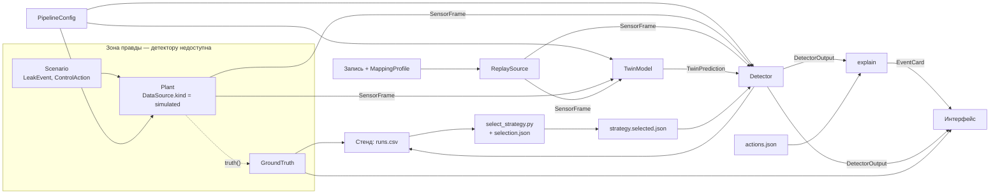

# Контракты между модулями PipeTwin

> Версия контрактов: **1** (`CONTRACTS_VERSION` в `packages/core/src/contracts.ts`, поле `schemaVersion` во всех JSON-файлах).
> Основано на ТЗ команды, раздел 7 ([docs/PipeTwin_TZ.md](PipeTwin_TZ.md)). Что уточнено относительно ТЗ и почему — в [разделе 17](#17-что-уточнено-относительно-тз).

## Содержание

1. [Что такое контракт и где он лежит](#1-что-такое-контракт-и-где-он-лежит)
2. [Карта контрактов](#2-карта-контрактов)
3. [Общие правила](#3-общие-правила)
4. [PipelineConfig — труба, среда, датчики](#4-pipelineconfig--труба-среда-датчики)
5. [SensorFrame — показания датчиков](#5-sensorframe--показания-датчиков)
6. [Twin — прогноз модели без утечки](#6-twin--прогноз-модели-без-утечки)
7. [Зона правды: утечки, управление, GroundTruth](#7-зона-правды-утечки-управление-groundtruth)
8. [DataSource — источник кадров](#8-datasource--источник-кадров)
9. [Detector — детектор утечки](#9-detector--детектор-утечки)
10. [Стратегия — strategy.selected.json](#10-стратегия--strategyselectedjson)
11. [Сценарий — scenarios/*.json](#11-сценарий--scenariosjson)
12. [Результат прогона — runs.csv](#12-результат-прогона--runscsv)
13. [Карточка события и правила рекомендаций](#13-карточка-события-и-правила-рекомендаций)
14. [Выбор стратегии — selection.json](#14-выбор-стратегии--selectionjson)
15. [Калибровка](#15-калибровка)
16. [Импорт: таблица, маппинг, разметка](#16-импорт-таблица-маппинг-разметка)
17. [Что уточнено относительно ТЗ](#17-что-уточнено-относительно-тз)
18. [Вопросы, которые закрываем вместе](#18-вопросы-которые-закрываем-вместе)

---

## 1. Что такое контракт и где он лежит

Контракт — договорённость о том, в каком виде одна часть системы передаёт данные другой: какие поля, в каких единицах, какие функции и что они возвращают. Пока контракт соблюдён, A, B и C работают параллельно и не ждут друг друга: каждый пишет код против типов и примеров, а не против чужой реализации.

| Что | Где | Роль |
| --- | --- | --- |
| Типы TypeScript | [`packages/core/src/contracts.ts`](../packages/core/src/contracts.ts) | **Главный источник правды** для кода. Только описания, без логики |
| JSON Schema | [`schemas/*.schema.json`](../schemas) | Форма файлов на диске. По ним валидируют zod (TS) и pydantic (Python), их же понимает редактор (подсказки и подсветка ошибок через поле `$schema`) |
| Примеры | [`configs/`](../configs), [`fixtures/`](../fixtures) | Рабочие образцы каждого файла. Должны проходить свою схему |
| Описание | этот документ | Смысл полей, единицы, инварианты, кто создаёт и кто использует |

Если тип и схема расходятся — это ошибка, правится в том же коммите.

## 2. Карта контрактов



| Контракт | Тип / файл | Создаёт | Использует |
| --- | --- | --- | --- |
| Конфиг трубы | `PipelineConfigInput` → `PipelineConfig`, `ResolvedConfig`; `configs/pipeline.*.json` | C (импорт), A (схема, `resolveConfig`) | A, B, C |
| Кадр датчиков | `SensorFrame`; `fixtures/frames.example.csv` | A (plant), C (запись, поток) | B, C |
| Прогноз twin | `TwinPrediction`, `TwinModel`, `PipeProfile` | A | B, C |
| Утечка и правда | `LeakEvent`, `ControlAction`, `GroundTruth` | A (plant), B (сценарии) | стенд, интерфейс — **не детектор** |
| Источник данных | `DataSource` | A (`SimulatedSource`), C (`ReplaySource`, `StreamSource`) | C, стенд |
| Детектор | `Detector`, `DetectorOutput`, `DetectorRequirements` | B | C, стенд |
| Стратегия | `SelectedStrategyFile`; `configs/strategy.selected.json` | B (`select_strategy.py`) | C, стенд |
| Сценарий | `Scenario`; `configs/scenarios/*.json` | B (C — экспорт сессии демо) | A, B, C |
| Результат прогона | `RunRecord`; `results/runs.csv` | B (раннер) | A, B, C |
| Карточка события | `EventCard`, `ActionRule`; `configs/actions.json` | B (`explain`) | C |
| Выбор стратегии | `SelectionFile`; `configs/selection.json` | B | `select_strategy.py` |
| Калибровка | `CalibrationRequest`, `CalibrationResult` | A | B, C |
| Импорт | `NormalizedTable`, `MappingProfile`, `LeakLabelsFile`; `configs/mappings/*.json` | C | C, B |

## 3. Общие правила

### 3.1. Единицы

Внутри системы — только СИ. Перевод единиц делается **на границе**: в загрузчике конфига (`resolveConfig`), в импорте файлов (`packages/io`) и при выводе в интерфейсе. Физика, детекторы и стенд не знают про бары и градусы Цельсия.

| Величина | Единица внутри | Примечание |
| --- | --- | --- |
| Давление | Па, **абсолютное** | Избыточное переводится на границе: p_абс = p_изб + `ambientPressure` |
| Температура | К | |
| Длина, координата, высота | м | Координата `x` — от входа участка вдоль трассы |
| Расход | м³/с, объёмный, в рабочих условиях | Массовый G = ρ·Q считает модель |
| Время | с | См. 3.2 |
| Плотность | кг/м³ | |
| Кинематическая вязкость | м²/с | Динамическая μ = ρ·ν считается моделью |
| Теплоёмкость | Дж/(кг·К) | |
| Коэффициент теплопередачи | Вт/(м²·К) | Отнесён к внутреннему диаметру |
| Модули упругости | Па | |
| Доли (размер утечки, уверенность) | безразмерные 0..1 | Исключения с суффиксом `Pct`/`_pct` — в процентах |

**Почему давление абсолютное.** Нужно и для q_leak (там перепад к атмосфере, его модель считает сама), и для проверки разрыва сплошности (давление насыщенных паров — абсолютное). Одна шкала внутри исключает путаницу; SCADA обычно отдаёт избыточное — это учитывает импорт (`pressureReference` в профиле маппинга).

**Строки с единицами в конфиге** (`"39 бар"`) по умолчанию тоже считаются абсолютным давлением. Избыточное помечается в единице: `"38 бар изб"`, `"3,8 МПа(и)"`, `"38 barg"`. Парсер A (WP-A1) обязан понимать эти формы.

### 3.2. Время

- Время — секунды от начала потока, `float`. Номер отсчёта нигде не передаётся.
- Внутри одного потока `t` строго возрастает. Шаг может быть неравномерным (дрожание, пропуски) — детекторы обязаны это выдерживать.
- Абсолютное время записи (если известно) хранится отдельно: `NormalizedTable.t0` в ISO 8601 UTC.
- Все параметры, связанные со временем (окна, задержки, прогрев), задаются в секундах, а не в отсчётах.

### 3.3. Датчики

- Датчик адресуется строковым `id`, а не индексом. Формат: `^[A-Za-z][A-Za-z0-9_-]*$`.
- Соглашение об именах: `<род>_<место>`: `p_in`, `p_km10`, `p_out`, `q_in`, `T_out`. Для дробных километров — `p_km12_5`.
- Набор датчиков задаётся конфигом. Код не предполагает, что какие-то датчики существуют: детектор объявляет требования (`requires`) и выбывает с причиной, если их нет.

### 3.4. Граница честности

- Детектор получает только `DetectorContext` (конфиг без утечек, датчики, twin), `SensorFrame` и `TwinPrediction`.
- Типы `LeakEvent`, `ControlAction`, `GroundTruth`, `PipeProfile` из plant, методы `injectLeak`, `applyControl`, `truth`, `profile` у `DataSource` детектору не передаются и в `packages/detect` не используются.
- Код в `packages/detect` не импортирует `packages/core/src/plant/**`. Проверяется линтером границ модулей в CI (подключит C).
- Интерфейс видит правду (для секундомера и маркера истинного места), но в воркер детектора её не передаёт; журнал сообщений, которые получает детектор, виден на экране.

### 3.5. Имена полей и форматы

- JSON-файлы и типы TS — `camelCase`. Единица, если она не СИ, — в суффиксе: `sizePct`, `rampSec`, `noisePct`, `rateHz`.
- CSV с результатами и метрики — `snake_case` (`ttd`, `far_per_day`): их читают pandas и люди в таблицах.
- В каждом JSON-файле есть `schemaVersion: 1` и, для подсказок редактора, `$schema` со ссылкой на схему.
- JSON — UTF-8, без комментариев. Пояснения — в поле `description`.

### 3.6. Как менять контракт

- **Добавить необязательное поле** — можно, предупредив остальных в чате.
- **Переименовать, удалить, сделать поле обязательным, поменять единицу или смысл** — только с согласия всех троих.
- Каждое изменение — отдельный коммит с префиксом `contracts:` (например, `contracts: add DetectorOutput.threshold`), в нём одновременно правятся `contracts.ts`, схема в `schemas/`, примеры и этот документ.
- Несовместимое изменение формата файлов повышает `CONTRACTS_VERSION` и `schemaVersion`.

## 4. PipelineConfig — труба, среда, датчики

**Создаёт:** C (импорт паспорта, форма), A (схема, `resolveConfig`). **Использует:** все.
**Типы:** `PipelineConfigInput`, `PipelineConfig`, `ResolvedConfig`, `ParamMeta`. **Схема:** [`schemas/pipeline.schema.json`](../schemas/pipeline.schema.json).
**Примеры:** [`configs/pipeline.default.json`](../configs/pipeline.default.json), [`configs/pipeline.example.json`](../configs/pipeline.example.json).

### 4.1. Две формы конфига

```
PipelineConfigInput  ──resolveConfig()──▶  ResolvedConfig { config: PipelineConfig, params: ParamMeta[], calibrationCandidates, warnings }
 (файл, как написал человек)                 (всё заполнено, всё в СИ, у каждого числа есть статус)
```

- **Входной** (`PipelineConfigInput`) — то, что лежит в `configs/pipeline.*.json` или пришло из импорта. Любое поле может отсутствовать, любое число можно записать с единицей.
- **Разрешённый** (`PipelineConfig`) — то, что получают twin, plant, детекторы и интерфейс. Все поля заполнены, все числа — в СИ, никаких строк с единицами.

Числовое поле во входном конфиге (`QuantityInput`) задаётся одним из трёх способов:

| Форма | Пример | Статус |
| --- | --- | --- |
| Число — уже в СИ | `"length": 50000` | `given` |
| Строка с единицей | `"length": "50 км"`, `"heatCapacity": "2,0 кДж/(кг·К)"` | `given` |
| Объект | `{ "value": 0.05, "unit": "мм", "status": "default", "source": "library:steel-new" }` | как указано |
| Поле отсутствует | — | `default`, значение из библиотеки |

Десятичная запятая и русские/английские обозначения допустимы (WP-A1).

### 4.2. Статусы параметров

| Статус | Значит | Кто ставит |
| --- | --- | --- |
| `given` | Явно задано во входном конфиге (дали организаторы или мы сами записали) | `resolveConfig` |
| `default` | Взято из библиотеки значений по умолчанию | `resolveConfig` |
| `calibrated` | Подобрано калибровкой по данным без утечки | `calibrate` |

Статусы живут в `ResolvedConfig.params` (`ParamMeta`), а не в самом `PipelineConfig`: физике нужны числа, интерфейсу и логам — происхождение. `path` в `ParamMeta` адресует поле через точку; датчик — по `id`: `"sensors.p_km10.bias"`.

### 4.3. Поля

**`geometry`**

| Поле | Единица | Смысл |
| --- | --- | --- |
| `length` | м | Длина участка |
| `diameter` | м | Внутренний диаметр |
| `wallThickness` | м | Толщина стенки |
| `wallModulus` | Па | Модуль упругости стенки (сталь ≈ 2,1·10¹¹); нужен для скорости волны |
| `roughness` | м | Эквивалентная шероховатость; типичный кандидат на калибровку |
| `elevation` | `[x, z][]`, м | Профиль высот; x по возрастанию от 0 до `length`, между точками — линейно; одна точка — горизонтальная труба |

**`fluid`**

| Поле | Единица | Смысл |
| --- | --- | --- |
| `name` | — | Имя из библиотеки (`light-crude`, `heavy-crude`, `diesel`, `water`, `natural-gas`) или своё |
| `phase` | — | `liquid` или `gas` (газ — заготовка WP-A9) |
| `density` | — | `constant {rho}` или `linear {rho20, xi}`: ρ(T) = ρ₂₀ − ξ·(T − 293,15) |
| `viscosity` | — | `constant {nu}`; `filonov-reynolds {nu0, T0, u}`: ν = ν₀·e^(−u(T−T₀)); `walther {points}` — по двум точкам [T, ν] (ASTM D341) |
| `heatCapacity` | Дж/(кг·К) | |
| `bulkModulus` | Па | Объёмный модуль K жидкости |
| `vaporPressure` | Па (абс.) | Ниже — разрыв сплошности, plant ограничивает давление и пишет предупреждение |

**`thermal`**: `ambientTemp` (К), `heatTransferCoef` (Вт/(м²·К), к внутреннему диаметру).

**`boundary`** — граничные условия для **plant** (twin их не использует, он берёт граничные значения из замеров, см. `twin`):

| Вход (`inlet.type`) | Поля | Смысл |
| --- | --- | --- |
| `pressure` | `pressure: Schedule` | Задано давление |
| `flow` | `flow: Schedule` | Задан расход |
| `pump` | `suctionPressure`, `H0` (м), `b` (с²/м⁵), `speed?` | Насос: H = H₀·s² − b·Q²; событие `pump` в сценарии меняет напор |

| Выход (`outlet.type`) | Поля | Смысл |
| --- | --- | --- |
| `pressure` | `pressure: Schedule` | Задано давление |
| `flow` | `flow: Schedule` | Задан расход |
| `valve` | `downstreamPressure`, `cv` (м²), `opening: Schedule` (0..1) | Задвижка перед резервуаром: Q = Cv·τ·√(Δp/ρ); событие `valve` меняет τ |
| `closed` | — | Заглушка |

`inletTemp` — температура продукта на входе, К.

`Schedule` — число (постоянное значение) или `{ points: [[t, value], …], interp: 'linear' | 'step' }`. До первой точки — значение первой, после последней — последней.

**`sensors`** — список `SensorSpec`. В разрешённом конфиге:

| Поле | Единица | Смысл |
| --- | --- | --- |
| `id`, `kind`, `x` | —, —, м | Идентификатор, род (`p`, `T`, `q`), положение |
| `label` | — | Подпись для интерфейса |
| `noiseStd` | ед. величины | СКО шума |
| `lagSec` | с | Запаздывание первого порядка |
| `drift`, `bias` | ед./с, ед. | Дрейф и постоянное смещение (`bias` — кандидат на калибровку) |
| `quantum` | ед. | Разрешение прибора |
| `range` | `[min, max]` | Шкала; выход за неё — флаг здоровья датчика |
| `dropoutProb`, `outlierProb`, `outlierScale`, `timeJitterSec` | —, —, доли σ, с | Порча сигнала в модели датчиков plant (WP-A7) |

Во **входном** конфиге шум можно задать по-человечески: `noisePct` (% ширины шкалы `range`, как в ТЗ — «0,2% шкалы») или `noiseK` (К, для температуры). `resolveConfig` переводит их в `noiseStd`. Одновременно `noiseStd` и `noisePct` задавать нельзя.

Для записей (replay) параметры порчи справочные: настоящий шум оценивает предобработка B по окну без утечки.

**`sampling.rateHz`** — номинальная частота опроса. **`ambientPressure`** — атмосферное давление, Па (по умолчанию 101 325).

**`twin`** — модель twin и граничные условия.

`model`: `transient` — нестационарная модель (та же схема MOC, что у plant, но без утечки и со «своими» параметрами из конфига), граничные условия — замеры давления на концах (если давления нет — расхода). Она повторяет волны от насоса и задвижки, поэтому смена режима не даёт невязки, а утечка — даёт. `steady` — квазистационарная модель «как у диспетчера». По умолчанию `transient`, если на обоих концах есть датчик давления или расхода, иначе `steady`.

Для `steady` — какие замеры берутся как граничные условия:

| `boundaryMode` | Граничные замеры | Прогнозирует |
| --- | --- | --- |
| `p_in+q_in` | давление и расход на входе | всё остальное |
| `p_in+p_out` | давления на концах; расход — методом стрельбы | промежуточные давления, расходы, температуры |
| `p_out+q_out` | давление и расход на выходе; интегрирование назад | всё остальное |
| `auto` | первый доступный из перечисленных выше по наличию датчиков | |

Датчики для граничных условий можно указать явно (`inletPressureSensor` и др.), иначе берутся датчики нужного рода с `x = 0` / `x = length`.

**`numerics`**: `dx` (м; шаг plant по времени Δt = dx/a), `frictionModel` (`colebrook` | `swamee-jain` | `haaland`), `thermalMode` (`none` | `quasi-steady` | `advection`), `waveSpeed?` — принудительная скорость волны (иначе формула Жуковского–Кортевега).

### 4.4. resolveConfig

`resolveConfig(input) → ResolvedConfig`:

- `config` — полный `PipelineConfig` в СИ;
- `params` — `ParamMeta` для каждого числового параметра: значение, статус, исходная запись, источник;
- `calibrationCandidates` — пути параметров со статусом `default`, которые имеет смысл подобрать по данным (шероховатость, теплопередача, смещения датчиков, параметры вязкости);
- `warnings` — некритичные замечания.

Ошибка входного конфига (отрицательный диаметр, неизвестная единица) — исключение с текстом, который называет **поле и причину** (`geometry.diameter: значение должно быть > 0, получено −0,5 м`), без стектрейса в интерфейсе (тест T-A18).

## 5. SensorFrame — показания датчиков

**Создаёт:** A (plant через модель датчиков), C (`ReplaySource`, `StreamSource`). **Использует:** B, C.

```ts
interface SensorFrame {
  t: number;                           // с от начала потока
  values: Record<string, number>;      // id датчика → значение в СИ
  valid?: Record<string, boolean>;     // false = пропуск или сбой
}
```

- `t` строго возрастает от кадра к кадру.
- Датчика без отсчёта в этом кадре может не быть в `values` — это то же, что `valid[id] = false`.
- `valid[id] = false` — значение есть, но им нельзя пользоваться (сбой, выход за шкалу по мнению источника). Отсутствие ключа в `valid` означает `true`.
- Порченые значения (шум, дрейф, выбросы) — нормальные валидные отсчёты: отделять их — работа предобработки B.

**Файловое представление** — CSV ([`fixtures/frames.example.csv`](../fixtures/frames.example.csv)):

```
t,p_in,q_in,T_in,p_km10,p_km25,p_out,q_out,T_out
0.0,3998156,0.30948,333.14,3511983,2901367,2370838,0.31100,318.57
```

- первая колонка `t` (с), дальше колонки с именами `id` датчиков;
- значения в СИ, давление абсолютное, разделитель `,`, десятичная точка, UTF-8;
- пустая ячейка — пропуск отсчёта (`valid = false`).

Это нормализованный формат, в который `packages/io` превращает любой чужой файл (через `MappingProfile`), и формат экспорта записей для стенда.

## 6. Twin — прогноз модели без утечки

**Создаёт:** A. **Использует:** B (детекторы, локализация L2), C (графики «замер и прогноз», схема трубы).

```ts
interface TwinModel {
  reset(cfg: PipelineConfig): void;
  predict(frame: SensorFrame): TwinPrediction;
  leakResponse?(x: number, q: number): Record<string, number>;
  profile?(): PipeProfile | undefined;
  steadyProfileFrom?(end: 'inlet' | 'outlet', p: number, q: number): PipeProfile;
}

interface TwinPrediction {
  t: number;
  values: Record<string, number>;
  inputs: string[];          // датчики, взятые как граничные условия
  ok: boolean;
  error?: string;
  sensitivities?: Record<string, Record<string, number>>;
}
```

- Twin видит **только кадры датчиков** и конфиг. Он не знает об утечке и не знает истинных параметров plant (в сценариях plant отличается через `truthOverrides`).
- `predict` берёт граничные замеры из кадра согласно `config.twin.boundaryMode` и возвращает ожидаемые значения на **всех** датчиках.
- `inputs` — датчики, которые twin использовал как граничные условия. Их прогноз совпадает с замером по построению; детектор **должен** исключать их из невязки, иначе получит нулевой сигнал и заниженную σ.
- `ok = false` — twin не смог посчитать (нет граничного замера в кадре, не сошлась стрельба). Тогда `values` может быть пустым; детекторы, которым нужен twin, пропускают кадр.
- `sensitivities` — ∂прогноз/∂параметр по путям параметров (`"geometry.roughness"`), считаются по запросу, для калибровки и детекторов.
- `leakResponse(x, q)` — отклик датчиков на гипотетическую утечку q (м³/с) в точке x (м): изменение показаний относительно прогноза без утечки. Нужен для локализации L2 (МНК-подбор места и расхода).
- `profile()` — профиль по узлам сетки (`PipeProfile`: `x`, `p`, `q`, `T` как `Float64Array`) для схемы трубы; `undefined`, пока расчёта не было.
- `steadyProfileFrom(end, p, q)` — стационарный профиль без утечки от одного конца трубы по давлению и расходу на нём; нужен локализации L1 (пересечение линий гидравлического уклона).
- Прогноз учитывает инерцию датчиков: граничные замеры уже запаздывают на свой `lagSec`, поэтому прогноз каждого датчика сглаживается фильтром с τ = lag датчика − lag граничных входов. Без этого инерционный расходомер «отставал» бы от прогноза на волне от насоса, и это выглядело бы как утечка.
- Старт: граничные замеры усредняются за первые 2 с (`ok = false` на это время), потом строится начальный профиль — старт из одного зашумлённого отсчёта дал бы долго гуляющую волну.

Невязка r = замер − прогноз и нормировка z = r/σ считаются **в B** (предобработка), а не в twin.

## 7. Зона правды: утечки, управление, GroundTruth

Эти типы знает только plant и то, что им управляет (стенд, интерфейс). **В детектор они не попадают.**

**`LeakEvent`** — утечка, внедряемая в plant:

| Поле | Единица | Смысл |
| --- | --- | --- |
| `id` | — | Идентификатор (несколько утечек одновременно) |
| `x` | м | Место |
| `area` | м² | Площадь отверстия при полном развитии |
| `cd` | — | Коэффициент расхода, обычно 0,6–0,65 |
| `tStart` | с | Начало |
| `rampSec` | с | Линейное нарастание площади от 0 до `area` |

Истечение: q_leak = C_d·A·√(2·p_изб/ρ), где p_изб = p − `ambientPressure`.

В сценариях размер удобнее задавать долей расхода (`sizePct`); перевод в площадь — забота plant (A): при заданной доле и установившемся давлении в точке x подбирается `area`.

**`ControlAction`** — ручное управление режимом (жюри «крутит насос»): `pump {changePct}`, `valve {opening}`, `noise {scale}`, `sensor-fault {sensorId, mode}`. Те же действия задаются событиями сценария.

**`GroundTruth`** — правда для метрик и секундомера: список `LeakTruth` (`x`, `tStart`, `tEnd?`, `rate?` м³/с, `fraction?` 0..1) и режимные события без утечки (для подсчёта ложных тревог в E5).

## 8. DataSource — источник кадров

**Создают:** A (`SimulatedSource` — наш plant), C (`ReplaySource` — запись, `StreamSource` — API организаторов). **Использует:** C (воркер демо), стенд B.

```ts
interface DataSource {
  readonly kind: 'simulated' | 'replay' | 'stream';
  readonly sensors: SensorSpec[];
  readonly sampleRateHz: number;
  readonly t: number;
  readonly done: boolean;
  step(dt: number): SensorFrame[];
  reset?(): void;
  injectLeak?(e: LeakEvent): void;     // только simulated
  applyControl?(a: ControlAction): void; // только simulated
  truth?(): GroundTruth;               // не передаётся детектору
  profile?(): PipeProfile;             // не передаётся детектору
}
```

**Семантика `step(dt)`.** Продвинуть время источника на `dt` и вернуть **все** кадры с `t` в полуинтервале (t_prev, t_prev + dt]. Три времени в системе независимы:

| Время | Пример | Кто задаёт |
| --- | --- | --- |
| Шаг расчёта plant | Δt = dx/a ≈ 0,09 с | Численная схема A |
| Период опроса датчиков | 0,1 с (10 Гц) | `sampling.rateHz` или запись |
| Тик интерфейса или стенда | 16–33 мс в демо, любой в стенде | C или раннер B |

Поэтому `step` может вернуть 0, 1 или несколько кадров. Пустой массив — «за этот интервал новых отсчётов нет», **не** конец данных. Конец данных — `done = true`.

`StreamSource` буферизует входящие кадры асинхронно и отдаёт накопленное синхронно из `step`, чтобы цикл обработки был одинаковым для всех источников.

## 9. Detector — детектор утечки

**Создаёт:** B. **Использует:** C (воркер демо), стенд.

```ts
interface Detector {
  readonly name: string;
  readonly requires: DetectorRequirements;
  check(ctx: DetectorContext): RequirementCheck;
  reset(ctx: DetectorContext, params: Record<string, number>): void;
  update(frame: SensorFrame, pred: TwinPrediction | null): DetectorOutput;
}
```

### 9.1. Жизненный цикл

1. `check(ctx)` — подходит ли детектор к набору датчиков. Возвращает `{ ok, reasons }`, не бросает исключений. Не подходит — детектор выбывает из турнира с причиной («нет расходомера на выходе»), остальные работают (тест T-B08).
2. `reset(ctx, params)` — сброс состояния и запуск с параметрами.
3. `update(frame, pred)` — на каждый кадр по возрастанию `t`. `pred = null`, если twin не нужен (`needsTwin = false`) или не смог посчитать (`ok = false`).

### 9.2. Требования

```ts
interface DetectorRequirements {
  sensors: Array<{ kind: 'p' | 'T' | 'q'; min?: number; at?: 'inlet' | 'outlet' | 'both-ends' | 'any' }>;
  minSensorsTotal?: number;   // D8, D9: ≥ 3
  minSampleRateHz?: number;   // D5: 10
  needsTwin: boolean;         // false для D8, D9
}
```

Пример: баланс массы D4 — `{ sensors: [{ kind: 'q', at: 'both-ends' }, { kind: 'p', min: 2 }], needsTwin: true }`.

### 9.3. Контекст и параметры

`DetectorContext` — `config` (`PipelineConfig`, в нём нет утечек), `sensors`, `sampleRateHz`, `twin?`. Twin передаётся ссылкой, чтобы локализация L2 могла вызвать `leakResponse`; plant не передаётся никогда.

Параметры (`DetectorParams = Record<string, number>`) задаются **в долях σ и в секундах**: порог `k = 3` (σ), окно `windowSec = 2`, дрейф CUSUM `k = 0.5` (σ). Так пороги переносятся между трубами, единицами и частотами опроса (тесты T-B03, T-B04).

### 9.4. Выход

| Поле | Единица | Смысл |
| --- | --- | --- |
| `t` | с | Время кадра, по которому принято решение |
| `phase` | — | `warmup` (оценка σ, тревог нет) → `running` → `suspect` (σ и онлайн-калибровка заморожены) → `alarm` |
| `alarm` | — | Тревога об утечке |
| `score` | безразмерный | Статистика детектора для порогов и графиков |
| `threshold?` | как `score` | Порог, с которым сравнивается `score` (для графика) |
| `location?`, `locationInterval?` | м | Оценка места и интервал, содержащий истинное место с вероятностью ≈ 90% (калибровка стендом) |
| `locationStage?` | — | Стадия оценки места: `segment` (отрезок у первого датчика, сразу) → `wave` (время прихода волны) → `profile` (профиль давлений) или `ml` (модель на данных симулятора) |
| `leaks?` | — | Все активные утечки (`ActiveLeak`: `id`, `tAlarm`, место, зона, стадия, расход, `state` — `detecting` или `confirmed`). Подтверждённая утечка учтена в норме, детектор ловит следующую; устранённая пропадает из списка сама |
| `leakRate?` | м³/с | Оценка расхода утечки |
| `z?` | σ | Нормированные невязки по датчикам |
| `eventClass?` | — | `leak`, `pump-change`, `valve-change`, `sensor-fault`, `unknown` (сигнатуры WP-B3) |
| `unhealthySensors?` | — | Датчики, признанные недостоверными (флаг, а не тревога) |
| `contributions?` | доли | Вклад датчиков в сигнал, сумма 1, по убыванию (для карточки события) |
| `onsetTime?` | с | Оценка момента начала события — для объёма потерь до тревоги |

Порог в выходе (`threshold`) — действующий: во время защиты от переходного режима он уже умножен на коэффициент защиты, поэтому на графике видно, почему тревоги нет.

### 9.5. Реестр

Детекторы регистрируются по имени (`DetectorRegistry`); стратегия ссылается на имя.

| ID ТЗ | Имя | Метод |
| --- | --- | --- |
| D1 | `threshold` | Порог на сглаженной z |
| D2 | `cusum` | Двусторонний CUSUM Пейджа |
| D3 | `ewma` | EWMA-карта |
| D4 | `mass-balance` | Баланс массы с поправкой на аккумуляцию |
| D5 | `npw` | Волна отрицательного давления |
| D6 | `kalman` | Фильтр Калмана с расширенным состоянием |
| D7 | `fusion` | Слияние нескольких детекторов |
| D8 | `rls` | Взаимное предсказание датчиков, без физики |
| D9 | `pca` | PCA и SPE, без физики |

| ID ТЗ | Имя | Метод локализации |
| --- | --- | --- |
| L1 | `hgl` | Пересечение линий гидравлического уклона |
| L2 | `lsq` | МНК-подбор (x, q) по откликам twin |
| L3 | `wave-timing` | Разница времён прихода волны: x = (L + a·(t₁ − t₂))/2 |

## 10. Стратегия — strategy.selected.json

**Создаёт:** B (`select_strategy.py`). **Использует:** C (стратегия по умолчанию в демо), стенд.
**Тип:** `SelectedStrategyFile`. **Схема:** [`schemas/strategy.schema.json`](../schemas/strategy.schema.json). **Файл:** [`configs/strategy.selected.json`](../configs/strategy.selected.json).

```json
{
  "schemaVersion": 1,
  "strategy": "cusum",
  "params": { "k": 0.5, "h": 6.2, "windowSec": 2 },
  "localization": "lsq",
  "signatureFilter": true,
  "warmupSec": 60,
  "selectedAt": "2026-11-08T18:00:00Z",
  "evidence": { "ttd_med_s": 1.8, "mdl_pct": 1.0, "far_per_day": 0.4, "loc_med_m": 210 },
  "runnerUp": "npw"
}
```

- Для слияния — `"strategy": "fusion"`, обязательны `members` (детектор, параметры, вес) и `fusionRule` (`vote` | `weighted-sum`).
- `selectedAt: null` и `evidence: null` — выбор ещё не проводился, в файле стратегия по умолчанию (D1 с порогом 3σ). Сейчас в репозитории лежит именно она.
- `evidence` — цифры прогона на тестовых seed, а не прогноз. `runsHash` — хэш `runs.csv`, по которому сделан выбор.

## 11. Сценарий — scenarios/*.json

**Создаёт:** B; C — экспорт сессии демо как сценария (WP-C6). **Использует:** A, B, C.
**Тип:** `Scenario`. **Схема:** [`schemas/scenario.schema.json`](../schemas/scenario.schema.json).
**Примеры:** [`example-leak.json`](../configs/scenarios/example-leak.json), [`example-regime-no-leak.json`](../configs/scenarios/example-regime-no-leak.json).

| Поле | Смысл |
| --- | --- |
| `id` | Уникальный идентификатор, попадает в `runs.csv` |
| `pipeline` | Путь к конфигу трубы от корня репозитория или сам конфиг |
| `truthOverrides` | Чем «настоящая» труба (plant) отличается от того, что знает twin. Те же поля, что во входном конфиге; применяются только к plant. Пример: `{ "geometry": { "roughness": "0,08 мм" } }` — twin считает 0,05 мм |
| `source` | `{ type: 'simulated' }` или `{ type: 'replay', file, mapping?, labels? }` |
| `durationSec`, `seed` | Длительность модельного времени, с; seed генератора |
| `noiseScale` | Множитель шума всех датчиков относительно конфига (по умолчанию 1) |
| `warmupSec` | Прогрев, до которого событий нет (по умолчанию 60) |
| `split` | `validation` (подбор порогов), `test` (итоговая оценка), `demo` |
| `events` | События по времени (ниже) |
| `overlayLeaks` | Утечки, накладываемые на запись без утечки через отклик twin (WP-B6) |
| `tags` | Метки для группировки в отчёте |

События:

| `type` | Поля | Смысл |
| --- | --- | --- |
| `leak` | `x` (м), `sizePct` **или** `area` (+ `cd`), `rampSec`, `id?` | Утечка |
| `pump` | `changePct`, `rampSec?` | Изменение напора насоса, % |
| `valve` | `opening` (0..1), `rampSec?` | Новая степень открытия задвижки на выходе |
| `noise` | `scale` | Новый множитель шума |
| `sensor-fault` | `sensorId`, `mode` (`stuck`/`step`/`drift`/`dropout`/`spike`), `magnitude?` (σ), `durationSec?` | Отказ датчика |

## 12. Результат прогона — runs.csv

**Создаёт:** B (раннер стенда). **Использует:** A, B, C. **Тип:** `RunRecord`, порядок колонок — `RUNS_CSV_COLUMNS`. **Пример:** [`fixtures/runs.example.csv`](../fixtures/runs.example.csv).

Строка — один прогон пары «сценарий × стратегия». CSV: разделитель `,`, десятичная точка, UTF-8, заголовок обязателен, **пустая ячейка = нет значения** (например, утечку не поймали).

| Колонка | Единица | Смысл |
| --- | --- | --- |
| `scenario_id` | — | `Scenario.id` |
| `strategy_id` | — | Имя и параметры через `;`: `cusum:k=0.5;h=6.2` (без запятых) |
| `seed` | — | seed прогона |
| `leak_present` | 0/1 | Есть ли утечка в сценарии |
| `leak_x` | м | Истинное место (первой) утечки |
| `leak_frac` | доля | Размер утечки, 0.02 = 2% расхода |
| `t_leak` | с | Начало утечки |
| `t_alarm` | с | Первая тревога после `t_leak`; пусто — пропуск |
| `ttd` | с | `t_alarm − t_leak` |
| `false_alarms` | шт. | Тревоги на участках без утечки (весь прогон или до `t_leak`) |
| `loc_est`, `loc_err` | м | Оценка места и `|loc_est − leak_x|` |
| `rate_est` | м³/с | Оценка расхода утечки |
| `rate_err` | доля | `|rate_est − истина| / истина` |
| `v_loss` | м³ | Вытекло до тревоги (при пропуске — до конца окна) |
| `cpu_ms_per_tick` | мс | Среднее время twin + детектор на тик |
| `split` | — | `validation` / `test` / `demo` *(дополнение)* |
| `noleak_s` | с | Время наблюдения без утечки — знаменатель FAR *(дополнение)* |
| `ttd_min_phys` | с | Физический минимум: расстояние до ближайшего датчика давления / a *(дополнение)* |
| `loc_lo`, `loc_hi`, `loc_stage` | м, — | Интервал места к концу прогона и его стадия (`segment`/`wave`/`profile`/`ml`); покрытие = доля `loc_lo ≤ leak_x ≤ loc_hi` *(дополнение)* |
| `loc0_lo`, `loc0_hi` | м | Интервал места в момент тревоги — первое, что видит оператор *(дополнение)* |

Производные метрики (ТЗ, раздел 13) считаются из этих колонок: TTD — медиана и p95 `ttd`; POD — доля непустых `t_alarm` по размеру утечки; MDL — минимальный `leak_frac` с POD ≥ 0,9; FAR — Σ`false_alarms` / Σ`noleak_s` · 3600 (в час) или · 86 400 (в сутки); LOC — медиана `loc_err`.

**Лог тиков** (`results/ticks/*.parquet`, опционально): колонки `t`, `score`, `alarm`, `z_<id>` по датчикам — для разбора отдельных прогонов. В git не хранится.

## 13. Карточка события и правила рекомендаций

**Создаёт:** B (`detect/src/explain.ts`). **Использует:** C (карточка в интерфейсе, экспорт истории в JSON). **Типы:** `EventCard`, `ActionRule`, `ActionsFile`. **Схема:** [`schemas/actions.schema.json`](../schemas/actions.schema.json).

`EventCard` появляется вместе с тревогой:

| Поле | Единица | Смысл |
| --- | --- | --- |
| `id`, `tAlarm` | —, с | Идентификатор и время тревоги |
| `eventClass`, `confidence` | —, 0..1 | Класс события и уверенность, откалиброванная по стенду |
| `detector` | — | Какая стратегия дала тревогу |
| `location` | м | `{ x, interval? }` — «км X ± ошибка» |
| `leakRate`, `leakFraction` | м³/с, доля | Расход утечки |
| `vLoss`, `vLossForecast30min` | м³ | Потери к моменту тревоги и прогноз при бездействии ещё 30 мин |
| `contributions` | доли | Вклад датчиков в score, сумма 1, по убыванию |
| `action` | — | `{ ruleId, severity, text }` — рекомендация с подставленными значениями |
| `acknowledgedAt?` | с | Оператор нажал «принять» |

**Правила** (`configs/actions.json`) проверяются **по порядку, срабатывает первое подходящее**. Условие `when` — все указанные поля должны выполниться; пустой `when` — правило «по умолчанию», ставится последним. Диапазоны полуоткрытые: `leakFractionMin ≤ f < leakFractionMax`, так же для уверенности.

Подстановки в `text`: `{place}` («на участке км A–B» — зона поиска ≈90%, «у км X», если интервала нет, или «место уточняется»), `{x_km}`, `{x_lo_km}`, `{x_hi_km}`, `{x_err_km}`, `{rate_m3h}`, `{frac_pct}`, `{sensor}`, `{confidence_pct}` — значения уже в «человеческих» единицах (км, м³/ч, %), перевод делает `explain`.

Правила в репозитории условные (по ТЗ, WP-B10). Дадут регламент — заменяем таблицу, код не трогаем.

## 14. Выбор стратегии — selection.json

**Создаёт:** B. **Использует:** `python/analysis/select_strategy.py`. **Тип:** `SelectionFile`. **Схема:** [`schemas/selection.schema.json`](../schemas/selection.schema.json). **Файл:** [`configs/selection.json`](../configs/selection.json).

| Поле | По умолчанию | Смысл |
| --- | --- | --- |
| `weights` | 0,35 / 0,15 / 0,25 / 0,15 / 0,10 | Веса N(TTD_med), N(TTD_p95), N(MDL), N(LOC_med), N(FAR) в счёте S; меньше — лучше |
| `ttdMinLeakFraction` | 0,02 | Медиана TTD — по утечкам от 2% расхода |
| `locMinLeakFraction` | 0,05 | Медиана ошибки места — по утечкам от 5%: их ловят все прошедшие фильтры стратегии, сравнение на одном наборе |
| `filters.farPerDayMax` | 2 | FAR на тесте, в сутки |
| `filters.podMin`, `podLeakFraction` | 0,9; 0,05 | POD ≥ 90% для утечек от 5% |
| `filters.regimeFalseAlarmsMax` | 0 | Ложные тревоги на режимных событиях E5 |
| `filters.cpuMsPerTickMax` | 2 | мс на тик в браузере |
| `targetFarPerDay` | 1 | Цель при подборе порогов на валидационных seed |
| `mdlPod` | 0,9 | Порог POD для MDL |
| `seeds` | 1–5 / 101–105 | Валидационные и тестовые seed |
| `bootstrap` | 1000; 0,95 | Пересэмплирования и уровень доверия |
| `simplicityOrder` | D1 < D3 < D2 < D4 < D8 < D9 < D5 < D6 < D7 | При статистической ничьей побеждает более простая |

Веса меняются, когда узнаем критерии жюри; код при этом не трогаем.

## 15. Калибровка

**Создаёт:** A (`core/src/calibrate/`, `python/reference/calibrate.py`). **Использует:** B (автонастройка), C (панель статусов).

```ts
calibrate(frames: SensorFrame[], cfg: ResolvedConfig, req: CalibrationRequest): CalibrationResult
```

- `CalibrationRequest`: `unknowns` — пути параметров (`"geometry.roughness"`, `"thermal.heatTransferCoef"`, `"sensors.p_km10.bias"`), `window` — окно **без утечки** [t0, t1], `bounds?`.
- `CalibrationResult`: `params` (`ParamMeta` со статусом `calibrated` и `std`, либо `default` с предупреждением, если не определяется), `config` с подставленными оценками, `identifiability` (ранг и число обусловленности якобиана, список неопределяемых параметров), `residualRms` по датчикам, `converged`, `iterations`.

Сигнатура функции фиксируется A при реализации WP-A8; типы входа и выхода — контракт уже сейчас.

## 16. Импорт: таблица, маппинг, разметка

**Создаёт:** C (`packages/io`). **Использует:** C (мастер маппинга), B (CLI импорта, replay-сценарии).

**`NormalizedTable`** — результат разбора любого файла до маппинга: `t` (с от первой строки, `Float64Array`), `t0?` (ISO 8601 UTC), колонки `{ name, data, kind?, unit? }` с угаданными родом и единицей, `warnings`.

**`MappingProfile`** (`configs/mappings/<имя>.json`, схема [`mapping.schema.json`](../schemas/mapping.schema.json), пример [`example-scada.json`](../configs/mappings/example-scada.json)) — как из таблицы получить кадры:

| Поле | Смысл |
| --- | --- |
| `file` | Разделитель, десятичный знак, кодировка, строки заголовка и единиц, лист Excel. Отсутствующее определяется автоматически |
| `time` | Колонка времени или пара [дата, время], формат (`iso`, `unix-s`, `unix-ms`, `excel` или шаблон `dd.MM.yyyy HH:mm:ss.SSS`), часовой пояс IANA |
| `columns` | Привязка колонок к датчикам: `source` (имя в файле), `sensorId`, `kind`, `unit`, `pressureReference` (`gauge` по умолчанию), `x?` |
| `ignore` | Колонки, которые пропускаем |

Применение одного профиля в браузере и в Node (`npm run import -- file.csv --mapping <имя>`) обязано давать побитово одинаковые кадры (T-C07).

**`LeakLabelsFile`** ([`leak-labels.schema.json`](../schemas/leak-labels.schema.json)) — разметка утечек в записи для replay-сценариев: `recording` и список `LeakTruth` (`id`, `x`, `tStart`, `tEnd?`, `rate?`, `fraction?`).

## 17. Что уточнено относительно ТЗ

Набросок типов в ТЗ (раздел 7.3) взят за основу. Ниже — изменения, без которых контракты либо были неполными, либо противоречили другим разделам ТЗ.

| Где | В ТЗ | В контрактах | Почему |
| --- | --- | --- | --- |
| Давление | Не указано, абсолютное или избыточное | Внутри — абсолютное; `ambientPressure` в конфиге; `pressureReference` в маппинге | Без этого A, B и C почти наверняка разойдутся; давление паров — абсолютное, SCADA отдаёт избыточное |
| `PipelineConfig` | Одна форма; WP-A1 требует у каждого поля `{value, unit, status, source}` | Две формы: входная (`PipelineConfigInput`, с единицами и статусами) и разрешённая (`PipelineConfig`, числа в СИ) + `ParamMeta` | Физике нужны числа, интерфейсу — статусы; совмещение в одном типе усложнило бы горячий цикл |
| `PropertyModel`, `Schedule` | Упомянуты, не определены | `DensityModel`, `ViscosityModel`, `Schedule` | Иначе нечего реализовывать |
| `boundary` | `inletPressure`, `outletPressure` | Варианты входа (`pressure`/`flow`/`pump`) и выхода (`pressure`/`flow`/`valve`/`closed`) | События сценария «насос» и «задвижка» (E5) требуют насоса и задвижки в граничных условиях plant (WP-A5) |
| `geometry` | Нет модуля упругости стенки | `wallModulus` | Нужен для скорости волны по Жуковскому–Кортевегу (WP-A5) |
| `fluid` | Нет давления паров и фазы | `vaporPressure`, `phase` | Защита от разрыва сплошности (WP-A5); заготовка под газ (WP-A9) |
| Конфиг | Нет частоты опроса и режима twin | `sampling.rateHz`, `twin.boundaryMode`, `numerics.thermalMode` | Twin работает в трёх режимах граничных условий (WP-A4); тепловой режим plant (WP-A6) |
| `SensorSpec` | `noiseStd`, `lagSec`, `drift`; в разделе 6 — `noisePct`, `noiseK` | В разрешённом — только `noiseStd`; `noisePct`/`noiseK` — во входном, переводятся в `noiseStd`; добавлены `bias`, `quantum`, `range`, вероятности сбоев | Согласовать разделы 6 и 7; WP-A7 перечисляет все виды порчи; `noisePct` без `range` не имеет смысла |
| `TwinPrediction` | `{t, values}` | + `inputs`, `ok`, `error`, `sensitivities`; интерфейс `TwinModel` | Невязка по граничным датчикам всегда ноль — детектор должен знать, какие исключать; WP-A4 требует чувствительности |
| `DataSource.step` | `step(dt): SensorFrame \| null` | `step(dt): SensorFrame[]` + `done`, `t`, `kind`, `sampleRateHz` | Шаг plant, период опроса и тик интерфейса разные: за один тик может прийти 0 или несколько кадров; «нет кадров» и «данные кончились» нужно различать |
| `DataSource` | Только `injectLeak` | + `applyControl`, `truth`, `profile`, `reset` | Жюри «крутит насос» на демо; секундомеру и стенду нужна правда; схеме трубы — профиль |
| `Detector.requires` | `Array<'p' \| 'T' \| 'q'>` | `DetectorRequirements`: род, количество, место, частота, нужен ли twin + метод `check` | D4 нужны расходомеры на **обоих** концах, D5 — частота от 10 Гц, D8/D9 — ≥ 3 датчика и без twin (WP-B2) |
| `Detector.reset` | `reset(cfg, params)` | `reset(ctx, params)`, `ctx` = конфиг, датчики, частота, twin | L2 нужен отклик twin; частота — для перевода секунд в отсчёты внутри детектора |
| `DetectorOutput` | `alarm`, `score`, `location?`, `leakRate?` | + `t`, `phase`, `threshold`, `locationInterval`, `z`, `eventClass`, `unhealthySensors` | График «невязка и порог», «км X ± ошибка», сигнатуры (WP-B3), здоровье датчиков (WP-B1) |
| Сценарий | `snake_case`: `duration_s`, `x_m`, `size_pct`, `ramp_s` | `camelCase`: `durationSec`, `x`, `sizePct`, `rampSec` | Единый стиль JSON во всём проекте (3.5); СИ-поля без суффиксов |
| Сценарий | Нет отличий plant от twin | `truthOverrides`, `split`, `source`, `overlayLeaks` | Раздел 3.2 (twin не знает истинных параметров), раздел 14 (валидация и тест), WP-B6 (replay и наложение) |
| `runs.csv` | 16 колонок | + `split`, `noleak_s`, `ttd_min_phys` в конце | FAR нельзя посчитать без длительности наблюдения без утечки; физический минимум — на слайд и в проверку честности (раздел 3.5) |
| Новые контракты | — | `EventCard`, `ActionRule`, `SelectionFile`, `CalibrationRequest/Result`, `NormalizedTable`, `MappingProfile`, `LeakLabelsFile` | Файлы `actions.json`, `selection.json`, `mappings/*.json` и передачи A → B (калибровка), B → C (карточка) есть в ТЗ, но без формата |
| `TwinSettings` | — | + `model: 'steady' \| 'transient'` | Нестационарный twin по граничным замерам повторяет волны от смены режима: E5 без ложных тревог, утечки на фоне режима ловятся за секунды |
| `TwinModel` | — | + `steadyProfileFrom`; `profile()` может вернуть `undefined` | Локализация L1; профиль до первого расчёта ещё не определён |
| `DetectorOutput` | — | + `contributions`, `onsetTime` | Карточка события: вклад датчиков и объём потерь до тревоги |
| `ActionRule.text` | — | + подстановка `{place}` | Пока волны не дошли, место неизвестно: «место уточняется» вместо «км ? ± ?» |

## 18. Вопросы, которые закрываем вместе

> Решения ниже приняты по умолчанию и реализованы; тесты и стенд их подтверждают. Пересматриваются только если появятся новые данные.

Решения по умолчанию уже записаны в контракты; если кто-то против — обсуждаем до вторника.

- [ ] Абсолютное давление внутри (п. 3.1) — все согласны?
- [ ] `step(dt)` возвращает массив кадров (п. 8) — C и B согласны?
- [ ] Перевод `sizePct` → площадь отверстия делает plant (A) по давлению в точке утечки на момент события — A согласен?
- [ ] Список подстановок в тексте рекомендаций (п. 13) — хватает ли C для карточки?
- [ ] Сигнатуру `calibrate()` A фиксирует к пятнице; до этого B использует только типы результата.
